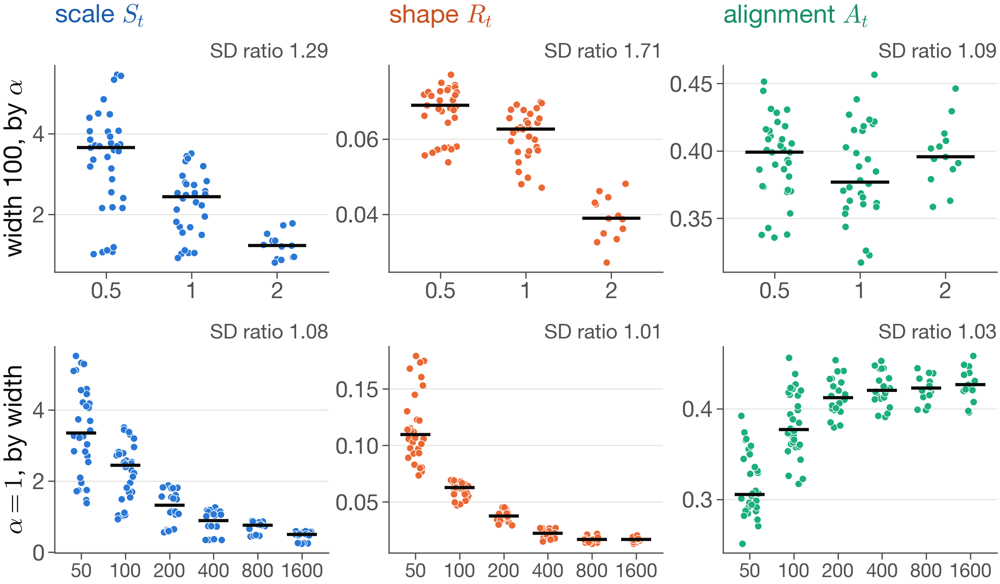
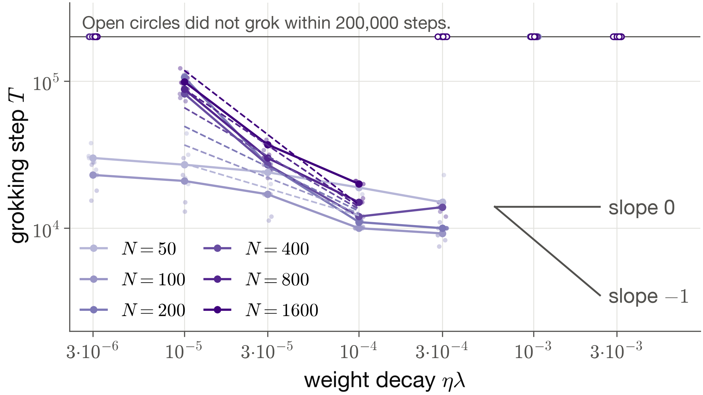
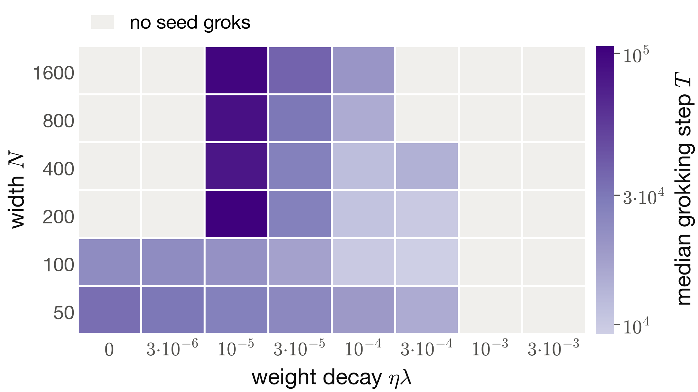
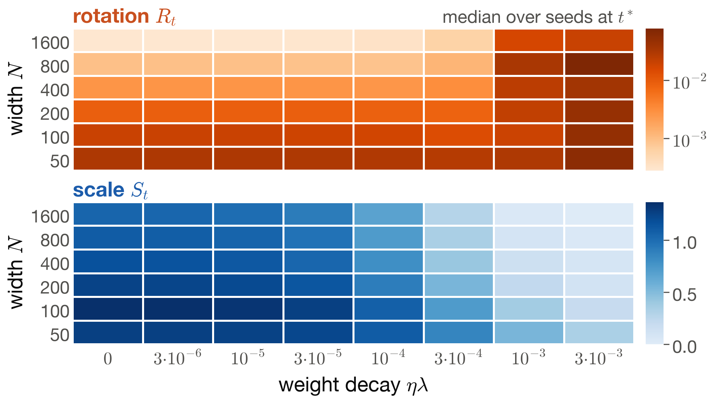
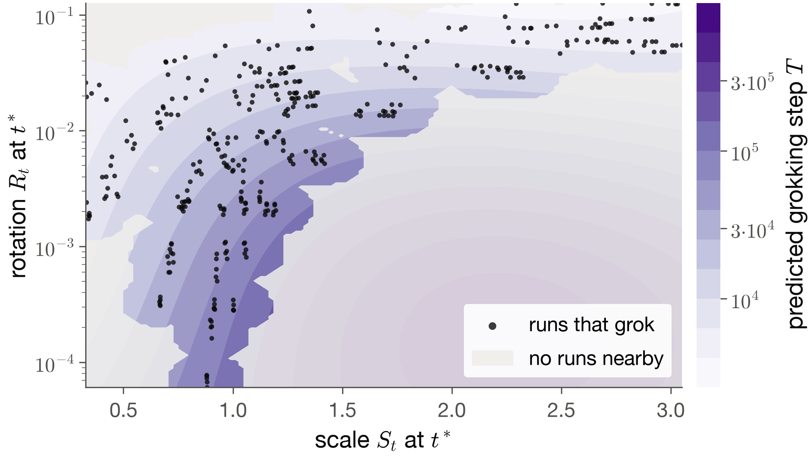
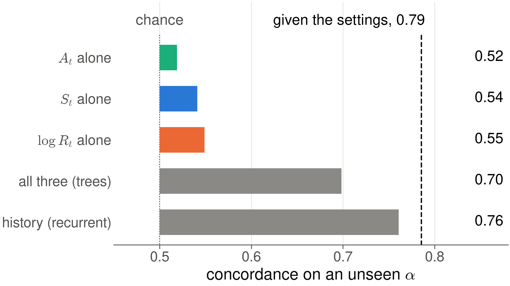

## {.g2-title-slide time="0:15"}

::: {.hidden}
$$
\require{color}
\definecolor{gscale}{RGB}{28,92,171}
\definecolor{grotation}{RGB}{201,80,31}
\definecolor{galignment}{RGB}{17,112,78}
\newcommand{\Sc}{{\color{gscale}S_t}}
\newcommand{\Rc}{{\color{grotation}R_t}}
\newcommand{\Ac}{{\color{galignment}A_t}}
\newcommand{\Fnorm}[1]{\lVert #1 \rVert_F}
$$
:::

```{=html}
<div class="g2-title-grid">
  <div>
    <p class="g2-eyebrow">STAT3007 seminar · Group G2</p>
    <h1 class="g2-title">Scale or Shape?</h1>
    <p class="g2-subtitle">Decomposing the movement of the neural tangent kernel during grokking</p>
    <p class="g2-authors">Zain Al-Saffi · Jasper Chong · Aaron D'Mello<br>Zac Kienzle · Samuel Rieger</p>
    <p class="g2-meta">Semester 2, 2026</p>
  </div>
  <div class="g2-title-art" aria-hidden="true">
    <svg viewBox="0 0 880 900" xmlns="http://www.w3.org/2000/svg">
      <g fill="none" stroke-width="5">
        <line x1="50" y1="215" x2="350" y2="85" stroke="#8a8986" stroke-width="2" stroke-dasharray="8 8"/>
        <ellipse cx="200" cy="150" rx="70" ry="34" transform="rotate(-23.4 200 150)" stroke="#2a78d6" stroke-opacity="0.3"/>
        <ellipse cx="200" cy="150" rx="105" ry="51" transform="rotate(-23.4 200 150)" stroke="#2a78d6" stroke-opacity="0.6"/>
        <ellipse cx="200" cy="150" rx="140" ry="68" transform="rotate(-23.4 200 150)" stroke="#2a78d6"/>
        <ellipse cx="200" cy="450" rx="140" ry="68" transform="rotate(-23.4 200 450)" stroke="#eb6834" stroke-opacity="0.3"/>
        <ellipse cx="200" cy="450" rx="140" ry="68" transform="rotate(8 200 450)" stroke="#eb6834" stroke-opacity="0.6"/>
        <ellipse cx="200" cy="450" rx="128" ry="80" transform="rotate(40 200 450)" stroke="#eb6834"/>
        <line x1="40" y1="800" x2="360" y2="700" stroke="#0b0b0b" stroke-width="2" stroke-dasharray="8 8"/>
        <ellipse cx="200" cy="750" rx="120" ry="60" transform="rotate(30 200 750)" stroke="#1baf7a" stroke-opacity="0.3"/>
        <ellipse cx="200" cy="750" rx="150" ry="42" transform="rotate(-17.4 200 750)" stroke="#1baf7a"/>
      </g>
      <g font-size="40" font-weight="600">
        <text x="400" y="145" fill="#1c5cab">scale</text>
        <text x="400" y="445" fill="#c9501f">rotation</text>
        <text x="400" y="745" fill="#11704e">alignment</text>
      </g>
      <g font-size="26" fill="#52514e">
        <text x="400" y="185">the kernel grows</text>
        <text x="400" y="485">the kernel changes shape</text>
        <text x="400" y="785">the kernel lines up with the labels</text>
        <text x="40" y="890" font-size="22" fill="#8a8986">schematic</text>
      </g>
    </svg>
  </div>
</div>
```

::: {.notes}
Speaker: TBD. Introduce the group and the question in one sentence each.

Say: We study grokking, where a network generalises long after it has fitted
its training data. We ask what sets the length of that delay. Our tool is the
neural tangent kernel, and our idea is to split its movement into three parts:
growth, change of shape, and alignment with the labels.
:::

# Grokking {.act time="0:05"}

A network fits its training data early. Why does it take so much longer to work
on data it has not seen?

## A network can fit its training data long before it generalises {time="0:35"}

:::: {.columns}
::: {.column width="62%"}
::: {.anim scene="GrokkingTimeline" status="planned" source="measured: baseline, seed 0" length="20 s"}
1. The step axis runs from 1 to 200,000 on a log scale.
2. Training accuracy, in grey, reaches 0.99 near step
   . A hollow marker shows memorisation.
3. Test accuracy, in ink, stays low and then climbs. A filled marker shows the
   grokking step $T$.
4. A bracket from step 0 to $T$ is labelled "grokking time".
5. Data: the baseline run ($\alpha = 1$, $N = 100$, $\eta\lambda = 0$, seed 0)
   from `report_v2/code/data`.
:::
:::
::: {.column width="38%" .g2-compact}
**Memorisation** is the first step at which training accuracy reaches 0.99.

**The grokking step $T$** is the first step at which test accuracy reaches
0.95.

::: {.g2-result}
In our baseline, memorisation comes at step  and
grokking at step , as medians over 5 seeds.
:::

::: {.g2-source}
Grokking was first reported on small algorithmic datasets
[@powerGrokkingGeneralizationOverfitting2022].
:::
:::
::::

::: {.notes}
Speaker: TBD.

Message: grokking is a long gap between fitting the training data and
generalising.

Say: Here is one of our baseline networks. Over five seeds, training accuracy
reaches 0.99 by a median step of . Test accuracy
stays low for much longer and only reaches 0.95 at a median step of
. That delay is grokking. We call the
step where test accuracy reaches 0.95 the grokking step T, and the whole talk
is about what sets T.
:::

## The task is addition on a clock with 23 hours {time="0:25"}

:::: {.columns}
::: {.column width="50%" .g2-compact}
- Each input is a pair $(a, b)$ with $a, b \in \{0, \dots, 22\}$. The target
  is $(a + b) \bmod 23$.
- All 529 pairs exist. Each seed trains on 476 of them and tests on the other 53.
- The network has one hidden layer of width $N$, a ReLU and no biases. It is
  trained on the squared error by full-batch gradient descent.

$$
f(x;\theta) = N^{-1/2}\, W^{(2)} \phi\!\left(D^{-1/2} W^{(1)} x\right), \qquad D = 46
$$

::: {.g2-source}
This is the baseline of @kumarGrokkingTransitionLazy2024 [App. 8.3, arXiv v3].
The network groks with no weight decay at all
[@gromovGrokkingModularArithmetic2023]. A small transformer solves the task by
turning addition into rotation about a circle
[@nandaProgressMeasuresGrokking2023].
:::
:::
::: {.column width="50%"}
::: {.anim scene="ModularAdditionTable" status="planned" source="the split of seed 0" length="15 s"}
1. A 23 by 23 grid. Row $a$ and column $b$ hold $(a + b) \bmod 23$, coloured by
   value, so equal sums form diagonal stripes.
2. The 476 training cells fade to grey. The 53 test cells stay bright.
3. The question appears: can the network fill in the bright cells?
:::
:::
::::

::: {.notes}
Speaker: TBD.

Message: the task is small and has a known structure, so we can study the
kernel exactly.

Say: The task is modular addition with modulus 23, like a clock with 23 hours.
Every one of the 529 pairs is in the dataset. Each run trains on 476 pairs and
must fill in the other 53. The network is a two-layer perceptron, and this is
the baseline that Kumar and coauthors used. It groks even without weight decay.
:::

## What sets the length of the delay is disputed {time="0:20"}

::: {.g2-cards}
::: {.g2-card .is-scale}
[Weight norm]{.g2-card-title}

Networks trained with weight decay grok when the weight norm reaches a critical
value [@khanhWeightNormSets2026]. Under cross-entropy the norm acts through the
scale of the logits [@khanhWhatDoesWeight2026].
:::

::: {.g2-card .is-ink}
[Weight-decay rate]{.g2-card-title}

The grokking time scales with $1/(\eta\lambda)$, the inverse of the product of
learning rate and weight decay
[@kimGrokkingWeightDecayClock2026; @pracherSpectralTheoryGrokking2026].
:::

::: {.g2-card .is-rotation}
[Lazy to rich]{.g2-card-title}

Grokking is the move from a fixed tangent kernel to one that adapts to the task
[@kumarGrokkingTransitionLazy2024].
:::
:::

::: {.g2-lead .fragment}
None of these accounts measures whether the kernel rotates. We ask whether the
grokking time follows the **shape** of the kernel, its **scale**, or the
**weight-decay rate**.
:::

::: {.notes}
Speaker: TBD.

Message: three published accounts give three different clocks, and none of
them looks at the shape of the kernel.

Say: Recent papers disagree about what sets the delay. One says the weight
norm. One says the weight-decay rate. One says grokking is a move from lazy to
rich training, where the network's kernel starts to adapt. To decide between
them we need to measure the kernel itself, so the next part explains what the
kernel is.
:::

# The tangent kernel {.act time="0:05"}

What does it mean for a network to learn features, and how could we see it
happen?

## The tangent kernel says how a step on one input moves the output on another {time="0:40"}

:::: {.columns}
::: {.column width="46%" .g2-compact}
$$
K(x, x') = \big\langle \nabla_\theta f(x;\theta),\, \nabla_\theta f(x';\theta) \big\rangle
$$

A gradient step on the loss at $x$ moves the weights along
$\nabla_\theta f(x;\theta)$. To first order, the output at $x'$ then moves by

$$
\Delta f(x') \approx -\eta\, K(x', x)\, \frac{\partial \ell}{\partial f}(x).
$$

So $K(x, x')$ measures how much the network treats $x$ and $x'$ alike. Over all
pairs it forms a matrix, the kernel $K$.

::: {.g2-source}
The tangent kernel is from @jacotNeuralTangentKernel2020.
:::
:::
::: {.column width="54%"}
::: {.anim scene="NTKFromScratch" status="planned" source="schematic" length="30 s"}
1. A small network with two inputs, $x$ and $x'$, and their outputs as two bars.
2. One gradient step pulls the output at $x$ towards its target.
3. The output at $x'$ moves too. The size of its move is $K(x', x)$.
4. Repeat for every pair. The values fill a heat map, the kernel matrix.
5. Inputs that the network treats alike light up together.
:::
:::
::::

::: {.notes}
Speaker: TBD.

Message: the kernel is the network's own similarity between inputs.

Say: Suppose we take one gradient step to fix the output on one input, x. The
weights move in the direction of the gradient at x. That changes the output on
every other input as well. For an input x-prime, the change is proportional to
this inner product of gradients, which is the tangent kernel. If the kernel is
large, the network treats the two inputs alike. Collect it over every pair and
you get a matrix that describes what the network currently thinks is similar.
:::

## In the lazy regime the kernel stays fixed during training {time="0:25"}

:::: {.columns}
::: {.column width="50%" .g2-compact}
- At infinite width the tangent kernel stays constant, and the network trains
  as a kernel method [@jacotNeuralTangentKernel2020].
- Scaling up the output makes training lazier
  [@chizatLazyTrainingDifferentiable2020]. We use the knob of Kumar and
  coauthors [@kumarGrokkingTransitionLazy2024]:

$$
\tilde f(x;\theta) = \alpha\,\big[f(x;\theta) - f(x;\theta_0)\big],
\qquad \eta = \eta_0/\alpha^2 .
$$

- A larger $\alpha$ gives lazier training. A rich network changes its kernel
  and learns features. Grokking may be the move from lazy to rich
  [@kumarGrokkingTransitionLazy2024].
:::
::: {.column width="50%"}
::: {.anim scene="LazyVersusRich" status="planned" source="schematic, then measured" length="25 s"}
1. The same network at $\alpha = 0.5$, $1$ and $2$.
2. At large $\alpha$ the weights barely move, so the kernel barely changes.
3. At small $\alpha$ the kernel changes during training.
4. Measured: in the baseline runs, the lazier the network, the later it groks.
   Data from E01 in `report_v2/code`.
:::
:::
::::

::: {.notes}
Speaker: TBD.

Message: alpha sets how lazy training is, and the lazy to rich account says
grokking happens when the kernel starts to move.

Say: For an infinitely wide network the kernel does not change, so training is
a fixed kernel method. That is the lazy regime. Multiplying the output by a factor
alpha pushes a network towards it. When the kernel does change, the network
learns new features, which is the rich regime. Kumar and coauthors propose that
grokking is the switch from lazy to rich.
:::

## The usual evidence is a distance, and a distance hides how the kernel moved {.optional time="0:20"}

$$
D_t = \frac{\Fnorm{K_t - K_0}}{\Fnorm{K_0}}
$$

- The kernel stays close to its start until the training data are fitted, and
  moves far from it afterwards [@mohamadiWhyYouGrok2024].
- A distance measures how far the kernel moved. It does not say how.

::: {.g2-source}
The relative variation $D_t$ is from @geigerDisentanglingFeatureLazy2020.
:::

::: {.notes}
Speaker: TBD.

Message: the evidence for lazy to rich is a single distance.

Say: The usual evidence that the kernel changes is this distance between the
kernel now and the kernel at the start. It stays small and then grows once the
training data are fitted. But a distance alone cannot tell us what kind of
change happened.
:::

## A kernel can grow, or it can change shape {time="0:25"}

::: {.anim .tall scene="ScaleVersusRotation" status="planned" source="schematic" length="25 s"}
1. Draw the kernel as an ellipse. Its axes are the eigenvectors, and their
   lengths are the eigenvalues.
2. Growth: the ellipse gets larger and keeps its axes. Every similarity is
   multiplied by one number.
3. Change of shape: the ellipse turns or changes its proportions. The kernel now
   treats different inputs alike.
4. Both paths travel the same distance $D_t$ from the start.
5. The word "schematic" stays on screen.
:::

::: {.notes}
Speaker: TBD.

Message: growth and change of shape are different events with different
meanings.

Say: Think of the kernel as an ellipse. Its axes say which directions in the
data the network cares about. The kernel can grow, so the ellipse gets bigger
but points the same way. Or it can change shape, so the ellipse turns or
stretches. Only the second one changes what the network treats as similar.
Both can produce the same distance from the start.
:::

## Three numbers describe how the kernel moved {time="0:35"}

::: {.g2-cards}
::: {.g2-card .is-scale .fragment}
[Scale]{.g2-card-title}

$$
\Sc = \frac{\Fnorm{K_t}}{\Fnorm{K_0}}
$$

It starts at 1. Above 1 the kernel has grown, and below 1 it has shrunk.
:::

::: {.g2-card .is-rotation .fragment}
[Rotation]{.g2-card-title}

$$
\Rc = 1 - \frac{\langle K_t, K_0 \rangle_F}{\Fnorm{K_t}\,\Fnorm{K_0}}
$$

It starts at 0 and ignores rescaling. It is 0 only when $K_t = cK_0$. It is
the kernel distance of @fortDeepLearningKernel2020.
:::

::: {.g2-card .is-alignment .fragment}
[Alignment]{.g2-card-title}

$$
\Ac = \frac{\langle CK_tC,\, CYY^\top C \rangle_F}{\Fnorm{CK_tC}\,\Fnorm{CYY^\top C}}
$$

It measures how well the kernel matches the labels and ignores rescaling. It
is the centred alignment of @cortesAlgorithmsLearningKernels2024.
:::
:::

::: {.g2-small}
$K_t$ is the tangent kernel of the summed logits divided by $\sqrt{p}$, on the
53 test pairs of a run [@mohamadiFastWellFoundedApproximation2022]. $C$ centres
a matrix and $Y$ holds the one-hot targets. We call $R_t$ the rotation, as the
report does. It measures any change of shape.
:::

::: {.notes}
Speaker: TBD.

Message: one number for growth, one for change of shape, one for agreement
with the labels.

Say: We measure three numbers on the kernel. Scale, in blue, is its size
relative to the start. Rotation, in orange, is one minus the cosine between the
kernel now and at the start, so it ignores size and only sees shape. Alignment,
in green, is how well the kernel lines up with the labels. These three colours
stay the same in every figure for the rest of the talk.
:::

## Seen as arrows, the three numbers are a length and two angles {.optional time="0:25"}

::: {.anim .tall scene="KernelAsArrows" status="planned" source="schematic" length="20 s"}
1. Treat each kernel matrix as one arrow, with the Frobenius inner product.
2. The arrow of $K_0$, then the arrow of $K_t$. The ratio of their lengths is
   the scale $S_t$.
3. The angle between them gives the rotation: $R_t$ is one minus its cosine.
4. After centring, the angle between the kernel and the label kernel $YY^\top$
   gives the alignment $A_t$.
5. Stretching an arrow changes $S_t$ and leaves both angles alone.
:::

::: {.notes}
Speaker: TBD.

Message: the three numbers are one length and two angles, which is why scale
cannot change the other two.

Say: Think of each kernel matrix as a single arrow. Scale is how much longer
the arrow got. Rotation is how far it turned away from where it started.
Alignment is how close it points to the labels. Stretching the arrow changes
the first number and not the other two.
:::

## The distance mixes growth and rotation {auto-animate="true" time="0:10"}

::: {data-id="identity" .g2-lead style="text-align:center; margin-top:2.2em;"}
$$
D_t^2 = {\color{gscale}S_t^2} - 2\,\Sc\,(1 - \Rc) + 1
$$
:::

::: {.notes}
Speaker: TBD.

Say: Because all three are measured on one matrix, the distance is a function
of scale and rotation.
:::

## The distance mixes growth and rotation {auto-animate="true" time="0:20"}

:::: {.columns}
::: {.column width="48%"}
::: {data-id="identity" .g2-lead}
$$
D_t^2 = \underbrace{(\Sc - 1)^2}_{\text{scale part}} + \underbrace{2\,\Sc\,\Rc}_{\text{rotation part}}
$$
:::

- A kernel that only grows has $R_t = 0$, so $D_t = |S_t - 1|$.
- A large $D_t$ therefore does not show that the kernel rotated.
:::
::: {.column width="52%"}
::: {.anim scene="IdentityLevelSets" status="exists as ScaleRotationLockstep, needs the report's definitions" source="identity, then measured" length="20 s"}
1. The plane of $S_t$ across and $R_t$ up, with grey lines of equal $D_t$.
2. A path along $R_t = 0$: pure growth.
3. A path that rotates at a fixed size.
4. Both end on the same grey line, so they have the same $D_t$.
5. The measured path of the baseline run, which stays close to the growth axis.
:::
:::
::::

::: {.notes}
Speaker: TBD.

Message: a big distance can come from growth alone.

Say: Rewritten, the squared distance is a scale part plus a rotation part. If
the kernel only grows, the rotation part is zero and the distance is just the
change in size. So a large distance does not prove that the network learned new
features. That is why we track scale and rotation separately.
:::

## On this task, the change of shape has a visible pattern {.optional time="0:30"}

::: {.anim .tall scene="KernelOnTheTorus" status="renders" source="measured: baseline, seed 0, all 529 pairs" length="30 s"}
1. The report's kernel on all 529 pairs, averaged over pairs with the same
   offsets $(a - a', b - b')$. At step 0 it is a cross, which is plain input
   overlap.
2. The target is the line $a + b \equiv a' + b'$.
3. The change of the normalised kernel from step 0 to step 31,000 falls on the
   cross and rises most along an X. One arm is the target line, and the other
   is the line $a - b \equiv a' - b'$.
4. The kernel is rebuilt from the saved weights of the baseline run with seed 0.
   The report measures it on the 53 test pairs, which are too few for this
   picture.
:::

::: {.notes}
Speaker: TBD.

Message: rotation is a concrete change in which pairs the network treats as
similar.

Say: This is the measured kernel change on our task. At the start the kernel
only knows which pairs share an input. Over training those pairs become less
alike, and the kernel changes most along two diagonals. One is where the sums
agree, which is the structure of the answer. The other is where the
differences agree, which the answer does not contain.
:::

## In theory, weight decay only rescales the kernel {time="0:25"}

$$
\frac{d\Theta_t(x,x')}{dt} =
\underbrace{-2(k-1)\lambda\,\Theta_t(x,x')}_{\text{rescales}}
+ \underbrace{T_t(x,x') + T_t(x',x)}_{\text{can rotate}}
$$

:::: {.columns}
::: {.column width="55%" .g2-compact}
- The weight decay $\lambda$ appears only in the first term, which rescales the
  kernel.
- Only $T_t$ can rotate it. At initialisation $T_0$ has expectation of order
  $1/N$ in the width $N$, as the same paper states.
- Our reading: if $T_t$ stays of order $1/N$ during training, a wider network
  rotates its kernel more slowly and should grok later.

::: {.g2-source}
The kernel flow is Eqs. S5 and S6 of @lewkowyczTrainingDynamicsDeep2021
[arXiv v2]. It assumes gradient flow and a $k$-homogeneous network, so for our
network it is a guide.
:::
:::
::: {.column width="45%"}
::: {.anim scene="KernelFlow" status="planned" source="schematic" length="20 s"}
1. The ellipse of the kernel.
2. The weight-decay term shrinks it evenly and keeps its axes.
3. The $T_t$ term turns it.
4. As the width grows, the $T_t$ arrow gets shorter.
:::
:::
::::

::: {.notes}
Speaker: TBD.

Message: weight decay alone cannot change the shape of the kernel, so a
rotation clock and a weight-decay clock make different predictions.

Say: Lewkowycz and Gur-Ari wrote down how the kernel changes under gradient
flow with weight decay. The weight decay only enters a term that shrinks the
kernel evenly. Any change of shape has to come from the second term, T, which
starts out small for wide networks. So if rotation sets the clock, and T stays
small during training, wider networks should grok later and the weight decay
should matter much less. That second step is our own reading.
:::

# The experiment {.act time="0:05"}

How can one experiment tell the three clocks apart?

## Each account predicts a different result {time="0:30"}

| Account | Fixed value at grokking (Tier 1) | Width exponent $a$ (Tier 2) | Decay exponent $b$ (Tier 2) | Early predictor (Tier 3$'$) |
|:---|:---|:---|:---|:---|
| [Rotation clock]{.g2-key .is-rotation}, our hypothesis | $R_t$ reaches a threshold | $a > 0$, since $T_t$ shrinks with width (ours) | $b \approx 0$ | $R_t$ |
| Weight-decay clock [@kimGrokkingWeightDecayClock2026; @pracherSpectralTheoryGrokking2026] | Not stated | $a \approx 0$ (ours) | $b \approx -1$ | $\eta\lambda$ alone |
| [Norm or scale clock]{.g2-key .is-scale} [@khanhWeightNormSets2026; @khanhWhatDoesWeight2026] | $S_t$ at grokking is fixed (ours) | Not stated | Not stated | $S_t$ |

::: {.g2-small}
The exponents are those of $\log T = c + a\log N + b\log(\eta\lambda)$.
"Ours" marks our reading of a source. Each test of the next slides answers one
column.
:::

::: {.notes}
Speaker: TBD.

Message: three tests, each of which separates the accounts.

Say: Each account makes different predictions. A rotation clock says grokking
happens when rotation reaches a fixed value, that wider networks grok later,
and that weight decay barely matters. A weight-decay clock says the time is
proportional to one over the weight decay. A norm clock says the scale is fixed
at grokking. We designed one test for each column of this table.
:::

## We trained 720 networks across laziness, width and weight decay {time="0:25"}

:::: {.columns}
::: {.column width="58%"}
| Setting | Values | What it tests |
|:---|:---|:---|
| Output scale $\alpha$ | 0.5, 1, 2 | How lazy training is |
| Width $N$ | 50 to 1600, six values | The size of $T_t$ |
| Weight decay $\eta\lambda$ | 0, and seven values from $3\times10^{-6}$ to $3\times10^{-3}$ | The weight-decay clock |

144 cells with 5 seeds each give 720 runs of 200,000 steps. Each seed has its
own split. The runs took  hours of compute in all.

::: {.g2-result}
A run that never reaches test accuracy 0.95 is kept. Its grokking step is
recorded as more than 200,000, which is a censored time.
:::
:::
::: {.column width="42%"}
::: {.anim scene="GridOfRuns" status="renders" source="design, report_runs.csv" length="15 s"}
1. Three panels of 6 by 8 cells, one per value of $\alpha$, with the width $N$
   down and the weight decay $\eta\lambda$ across.
2. Then the counts appear. There are $3 \times 6 \times 8 = 144$ cells with 5
   seeds each, so 720 runs. The clip reads the counts from the runs table.
:::
:::
::::

::: {.notes}
Speaker: TBD.

Message: one grid crosses all three knobs, so the accounts are tested on the
same runs.

Say: We trained 720 networks. The output scale alpha controls laziness. The
width controls how fast the kernel can rotate. The weight decay is the knob of
the weight-decay clock. Every combination has five seeds. Runs that never grok
are kept as censored data, so the slow cells are not thrown away.
:::

## Three tests, one for each column of the table {.optional time="0:15"}

::: {.g2-cards}
::: {.g2-card .is-ink}
[Tier 1]{.g2-card-title}

Does grokking happen at a fixed value of a statistic? A placebo test reads each
run at another run's grokking step.
:::

::: {.g2-card .is-ink}
[Tier 2]{.g2-card-title}

How does $T$ scale with width and weight decay? A censored log-normal fit of
$\log T$.
:::

::: {.g2-card .is-ink}
[Tier 3$'$]{.g2-card-title}

Which statistic, read before any run groks, predicts $T$? Models are scored on
cells they have not seen.
:::
:::

::: {.notes}
Speaker: TBD.

Say: Here are the three tests in order. We start with the baseline, then go
through them one by one.
:::

# Results {.act time="0:05"}

Which clock does the grokking time follow?

## Baseline: the network memorises early, groks late, and its kernel mostly grows {time="0:30"}

:::: {.columns}
::: {.column width="60%"}
::: {.anim scene="BaselineKernel" status="renders" source="measured: baseline, 5 seeds" length="25 s"}
1. $S_t$ on top and $R_t$ below against step, for the five seeds at
   $\alpha = 1$, $N = 100$ and $\eta\lambda = 0$. The line is the median and
   the band the range.
2. A hollow marker at the median memorisation step and a filled one at the
   median grokking step.
3. A bar splits $D_t^2$ at grokking into the scale part and the rotation part.
:::
:::
::: {.column width="40%" .g2-compact}
::: {.g2-result}
At $\alpha = 1$ the scale part carries  of $D_t^2$ at
grokking. By the last step the scale is $S_t$ = ,
while the rotation is only $R_t$ = . At $\alpha = 2$ no seed groks
within 200,000 steps.
:::

::: {.g2-small}
Lazier networks grok later, as in @kumarGrokkingTransitionLazy2024 [Fig. 2(c), arXiv v3].
:::
:::
::::

::: {.notes}
Speaker: TBD.

Message: on the baseline, the distance is mostly growth.

Say: These are the five baseline runs at alpha 1, with the median as the
line. They memorise at a median step of  and
grok at a median step of . Look at the kernel.
By the end the scale is  times its starting value,
while the rotation is only . At grokking,
 of the squared distance is growth. As Kumar and
coauthors found, lazier networks grok later, and at alpha 2 no seed groks
within 200,000 steps.
:::

## Tier 1: at a fixed width, rotation is the statistic most tied to grokking {time="0:45"}

:::: {.columns}
::: {.column width="58%"}
::: {.anim scene="PlaceboTest" status="new" source="measured: E03" length="25 s"}
1. Each dot is one run of width 100 that groks. Its height is $R_t$ at its own
   grokking step.
2. The dots sit in a narrow band. Their spread is the standard deviation (SD).
3. Each run is now read at the grokking step of another run, drawn at random.
   The band widens.
4. The tightening ratio is the placebo SD over the true SD, over 2,000 shuffles.
5. The same for $S_t$ and $A_t$. A ratio near 1 means no tie to the event.
:::
:::
::: {.column width="42%"}
At width 100, over  runs that grok, the
tightening ratio is

::: {.g2-result .is-rotation}
[rotation $R_t$: ]{.g2-key .is-rotation}

[scale $S_t$: ]{.g2-key .is-scale}

[alignment $A_t$: ]{.g2-key .is-alignment}
:::

No shuffle gave $R_t$ or $S_t$ a spread as small as the true one.
:::
::::

::: {.notes}
Speaker: TBD.

Message: the placebo test separates a real threshold from a statistic that
barely moves.

Say: If grokking happens when a statistic reaches a threshold, then that
statistic should take nearly the same value at every run's grokking step. But a
statistic that barely moves would pass that check too. So we also read each run
at somebody else's grokking step. A real threshold gets much looser when we do
that. Rotation tightens the most, by a factor of
. Alignment barely tightens at all.
:::

## The statistics at the grokking step of every run {.optional time="0:25"}

{.g2-fig}

::: {.g2-small}
Each dot is a run at its grokking step, and each bar is a median. The ratio on
each panel is the tightening ratio of the placebo test.
:::

::: {.notes}
Speaker: TBD. Use only if there is time, or keep it for questions.
:::

## Reaching that rotation is not enough to grok {time="0:20"}

- Across widths no statistic takes a fixed value at grokking. At $\alpha = 1$
  the ratios are  for $S_t$,
   for $R_t$ and  for
  $A_t$, and no $p$ is below 0.05.
- At grokking, $R_t$ falls from  at $N = 50$ to
   at $N = 1600$. Wider networks grok with
  less rotation, but later.
- There are  cells in which a seed memorises
  but none groks. In  of them, a seed
  still reaches the median rotation at grokking of its width.
- The alignment barely moves: its median is  at the start
  and  at grokking.

::: {.notes}
Speaker: TBD.

Message: rotation is tied to grokking within one width, but it is not a
universal threshold and it is not sufficient.

Say: The tie only holds within one width. Wider networks grok with less
rotation but take longer, which suggests that width sets how fast the kernel
rotates. And some networks reach the usual rotation without ever grokking, so
rotation alone does not make a network grok.
:::

## Tier 2: the grokking time depends on both width and weight decay {time="0:40"}

::: {.g2-compact}
$$
\log T = c + a\log N + b\log(\eta\lambda) + \gamma\log N\log(\eta\lambda) + \sigma\varepsilon
$$
:::

:::: {.columns}
::: {.column width="55%"}
{.g2-fig}
:::
::: {.column width="45%"}
| | $a$ | $b$ |
|:---|:---|:---|
| Rotation clock | $> 0$ | $\approx 0$ |
| Weight-decay clock | $\approx 0$ | $\approx -1$ |
| **Our fit** | **** | **** |
| 95% interval |  to  |  to  |

::: {.g2-small}
A censored log-normal fit on the  runs at $\alpha = 1$
with $10^{-5} \le \eta\lambda \le 10^{-4}$, where every seed groks. The
intervals resample cells, then seeds.
:::
:::
::::

::: {.notes}
Speaker: TBD.

Message: both knobs matter, so neither single clock is right.

Say: We fit how the grokking time scales with width and with weight decay. A
rotation clock predicts a positive width exponent and no decay effect. A
weight-decay clock predicts no width effect and an exponent of minus one. We
find both: a is  and b is . Both
intervals exclude zero, and neither value is what its account predicts on its
own.
Adding the next decay level, three times ten to the minus four, moves b towards
zero, so this holds for the range where every seed groks.
:::

## What the two clocks would look like {.optional time="0:25"}

::: {.anim .tall scene="TwoClocks" status="renders" source="measured: E06 fit" length="20 s"}
1. Two slices through the centre of the fit, $\log T$ against $\log N$ and
   $\log T$ against $\log(\eta\lambda)$.
2. The rotation clock rises with width with slope $a = 1$ and is flat in decay.
   This slope is our reading.
3. The weight-decay clock is flat in width and falls with slope $b = -1$ in
   decay.
4. Our fitted lines lie between the two in both slices.
:::

::: {.notes}
Speaker: TBD. Use this clip if the audience needs a picture of the exponents.
:::

## A wider network groks later and stops grokking at a smaller weight decay {.optional time="0:30"}

:::: {.columns}
::: {.column width="55%"}
{.g2-fig}
:::
::: {.column width="45%"}
- Without weight decay, only $N = 50$ and $N = 100$ grok within the budget.
- Every seed groks up to $\eta\lambda$ =  for
  $N \le 400$, and only up to  for
  $N = 800$ and $1600$.
- The weight decay that speeds grokking depends on the width.
:::
::::

::: {.notes}
Speaker: TBD. A practical point for anyone tuning weight decay.
:::

## Width sets the rotation, and at a fixed width weight decay shrinks the scale {.optional time="0:30"}

:::: {.columns}
::: {.column width="55%"}
{.g2-fig}
:::
::: {.column width="45%" .g2-compact}
Both maps are read at $t^* = 2{,}430$, before any run groks.

- Up to $\eta\lambda = 3\times10^{-4}$, the rotation changes with the width and
  hardly with the weight decay.
- The scale falls with the weight decay at every width.

::: {.g2-small}
Among runs that grok, width explains  of the spread
of $\log R_t$, and weight decay . The spread of
$S_t$ is shared: $\alpha$ explains , width
 and weight decay .
:::
:::
::::

::: {.notes}
Speaker: TBD.

Message: this links Tier 2 back to Tier 1.

Say: Read early, before any run groks, rotation depends on the width and hardly
on the weight decay. At a fixed width, the scale shrinks as the weight decay
grows. So width goes with rotation, weight decay goes with a smaller scale, and
the grokking time depends on both. These are associations, and we have not
tested a causal link.
:::

## Tier 3$'$: rotation is the best single predictor, and scale adds what rotation lacks {time="0:40"}

:::: {.columns}
::: {.column width="60%"}
::: {.g2-bars .stepwise max="0.6" label="Held-out $R^2$ of $\log T$, with one cell held out at a time"}
- [$A_t$]{.is-alignment var="EtenARsq"}
- [$S_t$]{.is-scale var="EtenSRsq"}
- [$\log R_t$]{.is-rotation var="EtenRRsq"}
- [$S_t$ and $A_t$]{var="EtenSARsq"}
- [$\log R_t$ and $A_t$]{var="EtenRARsq"}
- [$S_t$ and $\log R_t$]{var="EtenSRRsq"}
- [All three]{var="EtenSRARsq"}
:::
:::
::: {.column width="40%" .g2-compact}
- Rotation alone predicts the grokking time best.
- Adding scale to rotation raises $R^2$ from  to
  , so rotation does not carry everything.
- Alignment adds little. All three together reach .

::: {.g2-small}
Kernel ridge regression on the statistics at $t^* = 2{,}430$, before any run
groks:  runs that grok, with each of the
 cells held out in turn. The backup slides give the
concordance.
:::
:::
::::

::: {.notes}
Speaker: TBD.

Message: of the three statistics, rotation carries the most information about
when a network will grok, scale adds to it, and alignment adds little.

Say: Now we ask which statistic, measured early, tells us when a run will grok.
We read the three numbers at step 2,430, before any run has grokked, and
predict the grokking step of cells the model has never seen. Each bar appears
on a click. Alignment alone explains almost nothing. Scale explains more, and
rotation explains the most. Adding scale to rotation raises the held-out R
squared from  to . Adding alignment
on top only takes it to .
:::

## Growth shortens the grokking time more when the kernel has also rotated {.optional time="0:25"}

:::: {.columns}
::: {.column width="55%"}
{.g2-fig}
:::
::: {.column width="45%"}
In the censored model with all three statistics and their products, the
coefficient of $S_t \times \log R_t$ is , with a
cell-bootstrap interval from  to
.
:::
::::

::: {.notes}
Speaker: TBD.

Say: Rotation and scale interact. Growth of the kernel shortens the grokking
time more when the kernel has also rotated more.
:::

## Trees on the same three statistics rank runs better than a linear model {.optional time="0:30"}

:::: {.columns}
::: {.column width="55%"}
{.g2-fig}
:::
::: {.column width="45%"}
- On an unseen $\alpha$, a linear model on $S_t$, $\log R_t$ and $A_t$
  scores . Products of the statistics raise this to
  . A score of 0.5 is chance.
- Boosted trees on the same three numbers reach . So
  the link to the grokking time is non-linear.
- A recurrent network on the history reaches . A model
  given the settings still does best, at .
:::
::::

::: {.notes}
Speaker: TBD.

Message: the statistics are tied to the grokking time in a non-linear way,
and even the best model on them does not beat knowing the settings.

Say: Here each model ranks the runs of a value of alpha it has never seen,
scored by the concordance. A score of 0.5 is chance. A linear model on the
three statistics scores , and products of the
statistics take it to . Boosted trees on the same three
numbers reach , so the link is non-linear. Kernel ridge
scores only , because it learns only from the runs that
grok. A recurrent network that reads the whole history reaches
. A model given the width and the weight decay does best,
at . A share of  of the spread
of log R lies between cells, so the statistics cannot tell which seed of a
cell groks first.
:::

## Tier 4: does the split hold beyond modular addition? {time="0:30"}

:::: {.columns}
::: {.column width="50%"}
- We repeat the measurements on MNIST digits, after the setup of Omnigrok
  [@liuOmnigrokGrokkingAlgorithmic2023].
- 1,000 training images and all 10,000 test images. A three-layer ReLU network
  without biases, trained on the squared error.
- MNIST does not reach test accuracy 0.95 reliably, so the grokking event is
  test accuracy 0.80.
- Planned grid: 4 initial scales, 4 widths, 7 weight decays and 5 seeds, which
  is 560 runs of 500,000 steps.
:::
::: {.column width="50%"}
::: {.figure-todo name="MnistResult"}
1. On 16 October 2026 the sweep has not run. `mnist/RUN_SWEEP.md` says how to
   run it, and the notebooks in `mnist/model_fitting/` wait for its output.
2. Once it has run: accuracy, $S_t$, $R_t$ and $A_t$ against step, then the
   Tier 1 to Tier 3$'$ summaries.
3. Fallback: the best exploration cell in
   `mnist/exploration/results/mnist_optionB/`, labelled as exploration. It
   groks in 8 of 8 seeds, and its best test accuracy is 0.85 or 0.86.
4. The exploration runs log $S_t$ as a log ratio and lack the statistics of
   the summed logits. Only the sweep records $S_t$, $R_t$ and $A_t$ as the
   report defines them, on 128 training and 128 test images.
:::
:::
::::

::: {.notes}
Speaker: TBD.

Message: a second task tests whether the picture is specific to modular
addition.

Say: To be written once the sweep has run. Until then, describe the setup and
say plainly that the results are pending.
:::

# What we found {.act time="0:05"}

So what sets the grokking time?

## Limitations {time="0:25"}

- The main grid uses one task, one architecture and the NTK parameterisation.
- Each cell has 5 seeds, and each event is known only to the nearest checkpoint.
- The Tier 2 exponents depend on which weight-decay cells enter the fit.
- The kernel statistics do not separate the seeds of a cell, and the settings
  predict better than any kernel model.
- The kernel-flow result assumes gradient flow and a homogeneous network. Our
  centred network is not homogeneous, so the result is only a guide here.

::: {.notes}
Speaker: TBD.

Say: We used one task and one network family, so we cannot claim that the
picture holds in general. The width effect belongs to the NTK parameterisation. The exponents
depend on the range of weight decays. And the kernel statistics are not a
better forecast than the settings themselves.
:::

## Rotation matters most, and the clock is mixed {time="0:30"}

::: {.g2-cards .big}
::: {.g2-card .is-scale}
[Growth]{.g2-card-title}

The usual kernel distance mostly records growth. Split it into scale and
rotation before reading it as feature learning.
:::

::: {.g2-card .is-rotation}
[Rotation]{.g2-card-title}

At a fixed width, rotation is the statistic most tied to grokking. Reaching it
is not enough to grok.
:::

::: {.g2-card .is-ink}
[The clock]{.g2-card-title}

The grokking time grows with width ($a$ = ) and falls
with weight decay ($b$ = ). Each published clock describes
one part of it.
:::
:::

::: {.g2-small}
Next step: test whether the early rate of rotation falls as $1/N$.
:::

::: {.notes}
Speaker: TBD.

Say: There are three things to take away. First, the standard kernel distance is mostly
growth, so split it. Second, rotation is the statistic most tied to grokking
at a fixed width, but it is not sufficient. Third, the grokking time depends on
both width and weight decay. The published clocks are each part of the answer.
:::

## Thank you {time="0:05"}

::: {.g2-lead}
Questions?
:::

::: {.g2-small}
[To agree as a group]{.g2-todo-chip} We used an AI assistant (Claude, by
Anthropic) to help draft code, the report and this deck. We checked every
result and every reference ourselves.

The code and the data extract behind every number are in the repository, in
`report_v2/code`.
:::

# Backup {.backup}

Slides for questions.

## The identity behind the split

$$
\Fnorm{K_t - K_0}^2 = \Fnorm{K_t}^2 - 2\langle K_t, K_0\rangle_F + \Fnorm{K_0}^2
$$

Divide by $\Fnorm{K_0}^2$ and use
$\langle K_t, K_0\rangle_F = (1 - R_t)\,\Fnorm{K_t}\,\Fnorm{K_0}$:

$$
D_t^2 = S_t^2 - 2S_t(1 - R_t) + 1 = (S_t - 1)^2 + 2S_tR_t .
$$

By the Cauchy-Schwarz inequality, $R_t = 0$ exactly when $K_t = cK_0$ for some
$c > 0$, and then $D_t = |S_t - 1|$.

## The placebo test in numbers

| Runs | Statistic | SD at grokking | SD at placebo | Ratio | $p$ |
|:---|:---|:---|:---|:---|:---|
| $N = 100$ ( runs) | [$S_t$]{.g2-key .is-scale} |  |  |  |  |
| | [$R_t$]{.g2-key .is-rotation} |  |  |  |  |
| | [$A_t$]{.g2-key .is-alignment} |  |  |  |  |
| $\alpha = 1$ ( runs) | [$S_t$]{.g2-key .is-scale} |  |  |  |  |
| | [$R_t$]{.g2-key .is-rotation} |  |  |  |  |
| | [$A_t$]{.g2-key .is-alignment} |  |  |  |  |

::: {.g2-small}
The placebo SD is the median over 2,000 permutations with no fixed points. $p$
is the share of permutations with an SD no larger than the true one.
:::

## The Tier 2 fit and its checks

| Fit at $\alpha = 1$ | $a$ | $b$ | $\gamma$ |
|:---|:---|:---|:---|
| Main range, level 0.95 |  [, ] |  [, ] |  [, ] |
| Adding $\eta\lambda = 3\times10^{-4}$ |  [, ] |  [, ] |  [, ] |
| Level 0.80 |  [, ] |  [, ] |  [, ] |
| Level 0.90 |  [, ] |  [, ] |  [, ] |
| Memorisation step |  [, ] |  [, ] |  [, ] |

::: {.g2-small}
Brackets give 95% intervals from a bootstrap that resamples cells, then seeds.
The interval of $\gamma$ includes zero in the main range, so we do not claim its
sign. Wider networks memorise sooner, so the width effect on grokking is not a
delay in fitting the training data.
:::

## Tier 3$'$ in numbers

| Statistics at $t^*$ | Held-out $R^2$ | Concordance |
|:---|:---|:---|
| [$A_t$]{.g2-key .is-alignment} |  |  |
| [$S_t$]{.g2-key .is-scale} |  |  |
| [$\log R_t$]{.g2-key .is-rotation} |  |  |
| $S_t$ and $A_t$ |  |  |
| $\log R_t$ and $A_t$ |  |  |
| $S_t$ and $\log R_t$ |  |  |
| All three |  |  |

::: {.g2-small}
Share of the spread that lies between cells:  for
$\log T$,  for $S_t$,  for
$\log R_t$ and  for $A_t$.
:::

## How the prediction models were scored

- The statistics $S_t$, $\log R_t$ and $A_t$ are read at $t^* = 2{,}430$, a
  saved step before any run reaches the grokking level.
- The models are kernel ridge regression, a linear accelerated failure time
  model with interactions, gradient-boosted trees
  [@chenXGBoostScalableTree2016] and a gated recurrent unit on the history
  [@choLearningPhraseRepresentations2014].
- The five seeds of a cell are close copies, so whole cells or whole values of
  $\alpha$ are held out.
- Scores are the held-out $R^2$ and the concordance index, the share of pairs
  of runs put in the right order [@harrellEvaluatingYieldMedical1982].
- Censored runs enter through the likelihood of the accelerated failure time
  model [@kalbfleischStatisticalAnalysisFailure2002].

## Our baseline beside Kumar et al.

- We use their task and settings, which are width 100, the squared error,
  full-batch gradient descent with $\eta_0 = 100$, $p = 23$ and 90% of the
  pairs for training [@kumarGrokkingTransitionLazy2024, App. 8.3, arXiv v3].
- They do not state the parameterisation or the initialisation. We use the NTK
  parameterisation.
- Our grokking steps at $\alpha = 0.5$ and $\alpha = 1$ are close to those in
  their Fig. 2. Our networks fit the training pairs several times sooner.
- Every seed groks in  of the 48 cells at
  $\alpha = 0.5$,  at $\alpha = 1$ and
   at $\alpha = 2$.

## References

::: {#refs .g2-small}
:::
