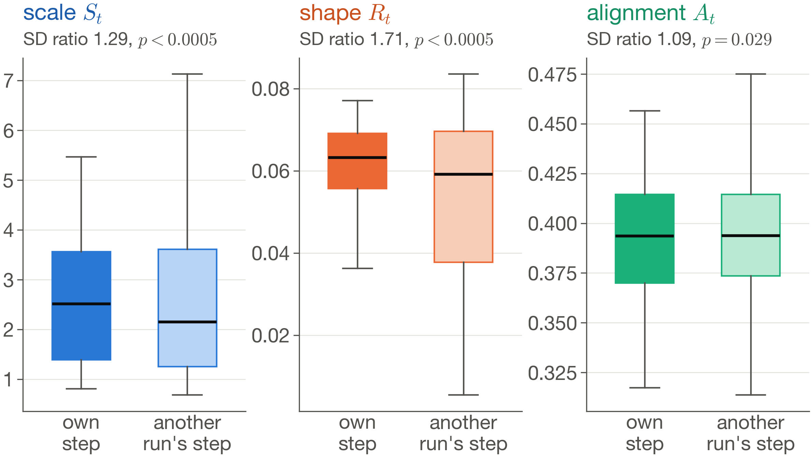
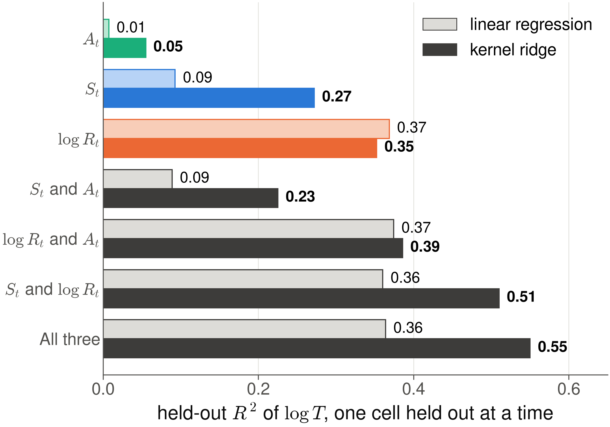
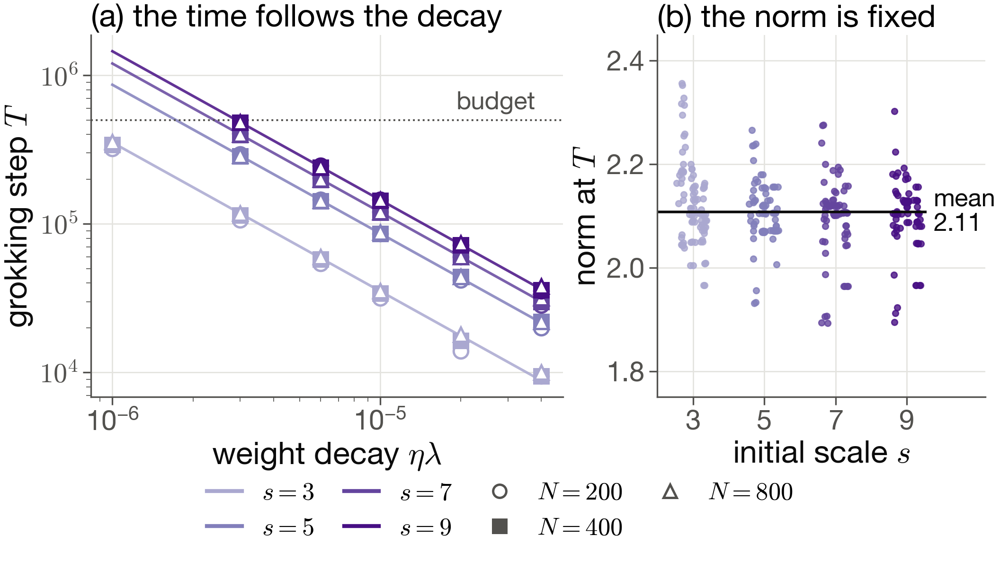
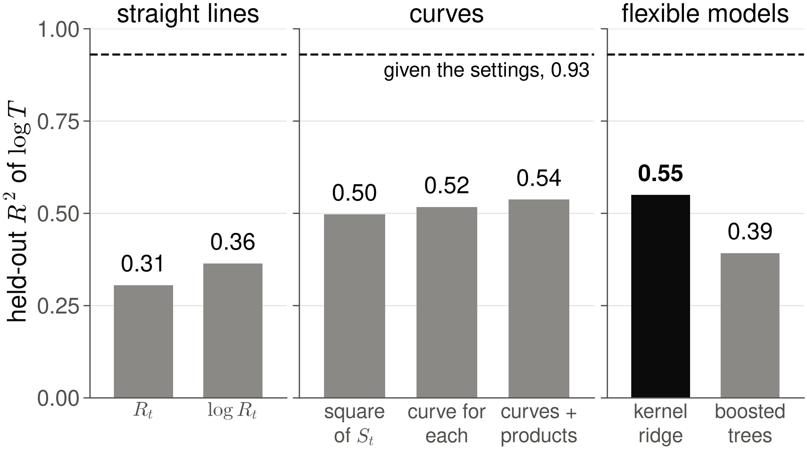
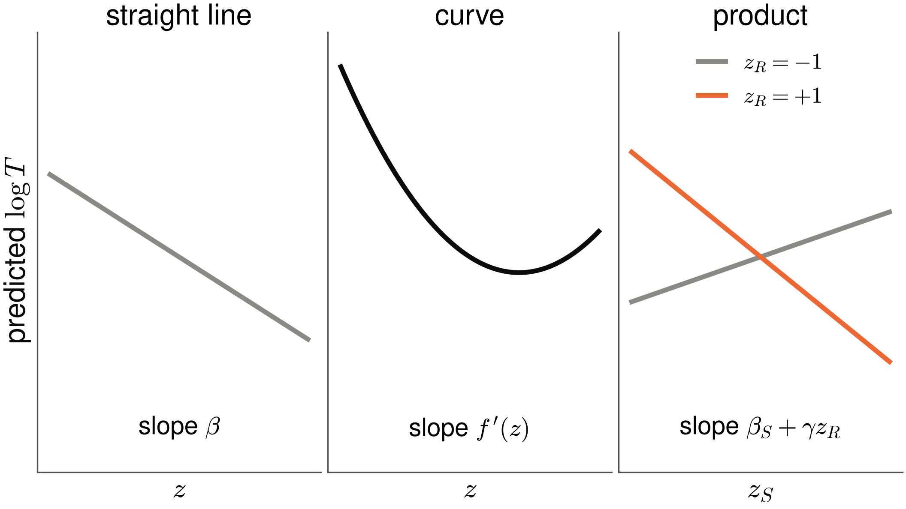
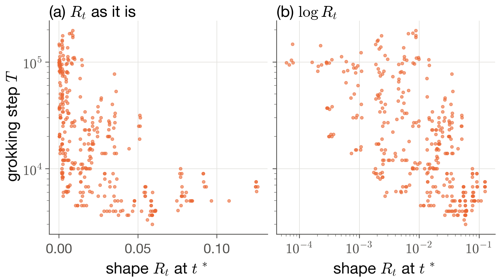

## {.g2-title-slide time="0:15"}

::: {.hidden}
$$
\require{color}
\definecolor{gscale}{RGB}{28,92,171}
\definecolor{grotation}{RGB}{201,80,31}
\definecolor{galignment}{RGB}{17,112,78}
\newcommand{\Sc}{{\color{gscale}S_t}}
\newcommand{\Rc}{{\color{grotation}R_t}}
\newcommand{\Ac}{{\color{galignment}A_t}}
\newcommand{\Fnorm}[1]{\lVert #1 \rVert_F}
$$
:::

```{=html}
<div class="g2-title-grid">
  <div>
    <p class="g2-eyebrow">STAT3007 seminar · Group G2</p>
    <h1 class="g2-title">Scale or Shape?</h1>
    <p class="g2-subtitle">Decomposing the movement of the neural tangent kernel during grokking</p>
    <p class="g2-authors">Zain Al-Saffi · Jasper Chong · Aaron D'Mello<br>Zac Kienzle · Samuel Rieger</p>
    <p class="g2-meta">Semester 2, 2026</p>
  </div>
  <div class="g2-title-art" aria-hidden="true">
    <svg viewBox="0 0 880 900" xmlns="http://www.w3.org/2000/svg">
      <g fill="none" stroke-width="5">
        <line x1="50" y1="215" x2="350" y2="85" stroke="#8a8986" stroke-width="2" stroke-dasharray="8 8"/>
        <ellipse cx="200" cy="150" rx="70" ry="34" transform="rotate(-23.4 200 150)" stroke="#2a78d6" stroke-opacity="0.3"/>
        <ellipse cx="200" cy="150" rx="105" ry="51" transform="rotate(-23.4 200 150)" stroke="#2a78d6" stroke-opacity="0.6"/>
        <ellipse cx="200" cy="150" rx="140" ry="68" transform="rotate(-23.4 200 150)" stroke="#2a78d6"/>
        <ellipse cx="200" cy="450" rx="140" ry="68" transform="rotate(-23.4 200 450)" stroke="#eb6834" stroke-opacity="0.3"/>
        <ellipse cx="200" cy="450" rx="140" ry="68" transform="rotate(8 200 450)" stroke="#eb6834" stroke-opacity="0.6"/>
        <ellipse cx="200" cy="450" rx="128" ry="80" transform="rotate(40 200 450)" stroke="#eb6834"/>
        <line x1="40" y1="800" x2="360" y2="700" stroke="#0b0b0b" stroke-width="2" stroke-dasharray="8 8"/>
        <ellipse cx="200" cy="750" rx="120" ry="60" transform="rotate(30 200 750)" stroke="#1baf7a" stroke-opacity="0.3"/>
        <ellipse cx="200" cy="750" rx="150" ry="42" transform="rotate(-17.4 200 750)" stroke="#1baf7a"/>
      </g>
      <g font-size="40" font-weight="600">
        <text x="400" y="145" fill="#1c5cab">scale</text>
        <text x="400" y="445" fill="#c9501f">shape</text>
        <text x="400" y="745" fill="#11704e">alignment</text>
      </g>
      <g font-size="26" fill="#52514e">
        <text x="400" y="185">the kernel grows</text>
        <text x="400" y="485">the kernel changes shape</text>
        <text x="400" y="785">the kernel lines up with the labels</text>
        <text x="40" y="890" font-size="22" fill="#8a8986">schematic</text>
      </g>
    </svg>
  </div>
</div>
```

::: {.notes}
Turn 1.

Message: we study what sets the delay in grokking by watching the tangent kernel.

Say:

- We are group G2, and our project is about grokking, where a network generalises long after it fits its training data.
- We tracked the network's tangent kernel during training to find out what sets the length of that delay.
:::

# Grokking {.act time="0:05"}

What does it mean for a network to grok?

## A network can fit its training data long before it generalises {time="0:35"}

:::: {.columns}
::: {.column width="62%"}
::: {.anim scene="GrokkingTimeline" status="renders" source="measured: baseline, seed 0" length="7 s"}
1. The step axis runs from 1 to 200,000 on a log scale.
2. Training accuracy, in grey, reaches 0.99. A hollow grey marker labelled
   "memorised" marks the memorisation step.
3. Test accuracy, in ink, stays low and then climbs. A filled ink marker
   labelled "generalised" marks the grokking step $T$.
4. A brace from step 1 to $T$ is labelled "grokking step $T$".
5. The data are the baseline run ($\alpha = 1$, $N = 100$, $\eta\lambda = 0$,
   seed 0) from `report_v2/code/data`.
:::
:::
::: {.column width="38%"}
::: {.g2-result}
[Memorisation]{.g2-card-title}

The first step at which training accuracy reaches 0.99.
:::

::: {.g2-result}
[Grokking step $T$]{.g2-card-title}

The first step at which test accuracy reaches 0.95.
:::

::: {.g2-result}
[The gap]{.g2-card-title}

Over five seeds the median memorisation step is
 and the median grokking step is
.
:::
:::
::::

::: {.notes}
Turn 1.

Message: grokking is a long gap between fitting the training data and
generalising.

Say:

- This is one of our baseline networks learning modular addition.
- Training accuracy, in grey, reaches 0.99 early, and we call that step memorisation.
- Test accuracy, in black, stays near zero and climbs much later, and the step where it reaches 0.95 is the grokking step T.
- Over five seeds, the median memorisation step is  and the median grokking step is .
- That gap is grokking, and the rest of the talk asks what sets its length.

Point at:

- The hollow marker is memorisation and the filled marker is the grokking step.

If asked:

- We take the levels from Khanh and coauthors, who use 0.99 for memorisation and check their result at test accuracy 0.80, 0.90 and 0.95.
- We report 0.95 and repeated every analysis at 0.80 and 0.90, and the signs of our scaling exponents hold at every level.
:::

## The task is modular addition {time="0:25"}

:::: {.columns}
::: {.column width="52%"}
::: {.g2-result}
[The task]{.g2-card-title}

The input is a pair $(a, b)$ with $a, b \in \{0, \dots, 22\}$. The target is
$(a + b) \bmod 23$, so $(20 + 5) \bmod 23 = 2$.
:::

::: {.g2-result}
[The split]{.g2-card-title}

Train 476 of the 529 pairs, tests on the other 53.
:::

::: {.g2-result}
[The network]{.g2-card-title}

The network has one hidden layer of width $N$. It is trained on the squared
error by full-batch gradient descent.

$$
f(x;\theta) = N^{-1/2}\, W^{(2)} \phi\!\left(D^{-1/2} W^{(1)} x\right), \qquad D = 46
$$
:::
:::
::: {.column width="48%"}
::: {.anim scene="ModularAdditionTable" still="true" status="renders" source="the split of seed 42" length="5 s"}
1. In a 23 by 23 grid, row $a$ and column $b$ hold $(a + b) \bmod 23$, shaded
   by value.
2. The 476 training cells fade. The 53 test cells keep their shade and get an
   outline.
3. The question appears: can the network fill in the outlined cells?
4. The slide shows the last frame as a still.
:::
:::
::::

::: {.notes}
Turn 1.

Message: the task is small and standard, so we can measure the kernel exactly.

Say:

- Our task is modular addition with modulus 23.
- The network sees two numbers and must output their sum mod 23, so 20 plus 5 gives 2.
- Each run trains on 476 of the 529 pairs and must fill in the other 53, the outlined cells.
- This task is a standard test bed in the theory of grokking, and our setup is the baseline of Kumar and coauthors.

If asked:

- We divide by the square root of N because this is the NTK parameterisation of Jacot and coauthors.
- Those factors give the network and its kernel a limit as the width grows, so networks of different widths have kernels on the same scale.
- The network has a ReLU and no biases, and its input is the one-hot vectors of a and b side by side, so D is 46.
- It is trained on the squared error by full-batch gradient descent with learning rate 100.
:::

# The tangent kernel {.act time="0:05"}

What does it mean for a network to learn features, and how could we see it
happen?

::: {.notes}
Turn 2.

Say:

- To answer that we need one tool, the tangent kernel.
:::

## The tangent kernel shows which inputs the network treats alike {time="0:35"}

::: {.g2-lead}
The tangent kernel is a snapshot of the features a network learns with.
:::

$$
K(x, x') = \big\langle \nabla_\theta f(x;\theta),\, \nabla_\theta f(x';\theta) \big\rangle
$$

- A gradient step on $x$ moves the output at $x'$ in proportion to $K(x', x)$.
- Near its start the network is a linear model on the features
  $\nabla_\theta f$ [@chizatLazyTrainingDifferentiable2020].
- If $K$ stays fixed, training ends at kernel regression with $K$
  [@jacotNeuralTangentKernel2020].

::: {.notes}
Turn 2.

Message: the kernel is the network's own similarity between inputs, and it
shows which features the network learns with.

Say:

- Suppose we take one gradient step to fix the output on one input, x.
- The weights move, so the output on every other input moves too.
- For another input x-prime, that move is set by the inner product of the two gradients, which is the tangent kernel.
- Near its start the network is a linear model on these gradient features, and if the kernel stays fixed, training ends at kernel regression with it.
- So the kernel is a snapshot of the features the network learns with.

If asked:

- Section 5 of Jacot and coauthors shows that in the infinite-width limit the trained network equals kernel ridge regression with the tangent kernel as the ridge goes to zero.
- Their result has a second term that comes from the network at the start, and our centred network starts at zero, so that term vanishes.
- The linear model is defined in Section 1.1 of Chizat, Oyallon and Bach.
:::

## Grokking may be the move from a fixed kernel to one that learns features {time="0:30"}

:::: {.columns}
::: {.column width="52%" .g2-compact}
- **Lazy.** The kernel stays near its start, as in kernel regression.
- **Rich.** The kernel changes, and the network learns features.
- Grokking may be the move from lazy to rich
  [@kumarGrokkingTransitionLazy2024].
- A larger output scale $\alpha$ keeps the network lazy for longer
  [@chizatLazyTrainingDifferentiable2020].

$$
\tilde f(x;\theta) = \alpha\,\big[f(x;\theta) - f(x;\theta_0)\big],
\qquad \eta = \eta_0/\alpha^2
$$
:::
::: {.column width="48%"}
::: {.anim scene="LazyVersusRich" still="true" status="renders" source="schematic, then measured" length="8 s"}
1. The schematic part shows the same network at $\alpha = 0.5$, $1$ and $2$.
2. The measured part, which is the last frame and the still on the slide,
   shows test accuracy of the baseline runs at the three values of $\alpha$.
   The lazier the network, the later it groks.
:::
:::
::::

::: {.notes}
Turn 2.

Message: alpha sets how long a network stays lazy, and the lazy to rich
account says grokking happens when the kernel starts to move.

Say:

- In the lazy regime the kernel barely moves, so the network acts like kernel regression with the kernel it started with.
- In the rich regime the kernel changes, so the network learns new features.
- Kumar and coauthors propose that grokking is the move from lazy to rich.
- Their knob is alpha, which scales the output, and a larger alpha lets the weights move less, so the network stays lazy for longer.
- In our runs, the lazier the network, the later it groks.

Point at:

- The plot shows test accuracy at three values of alpha, and at alpha 2 no seed groks within 200,000 steps.

If asked:

- The centred predictor and the learning rate divided by alpha squared are from Kumar and coauthors, Appendix 8.1.
- Chizat, Oyallon and Bach show in Section 1.2 that scaling the output by a large factor makes training lazy.
:::

## A kernel can grow or change shape, and a distance cannot tell which {time="0:35"}

:::: {.columns}
::: {.column width="48%" .g2-compact}
The usual measure of how far the kernel has moved is a distance
[@geigerDisentanglingFeatureLazy2020; @mohamadiWhyYouGrok2024].

$$
D_t = \frac{\Fnorm{K_t - K_0}}{\Fnorm{K_0}}
$$

It splits exactly into a part for size and a part for shape.

$$
D_t^2 = \underbrace{(\Sc - 1)^2}_{\text{scale part}} + \underbrace{2\,\Sc\,\Rc}_{\text{shape part}}
$$

::: {.g2-result}
In our baseline, the scale part is  of $D_t^2$ at
grokking.
:::
:::
::: {.column width="52%"}
::: {.anim scene="ScaleVersusRotation" status="renders" source="schematic" length="8 s"}
1. Draw the kernel as an ellipse. Its axes are the eigenvectors, and their
   lengths are the eigenvalues.
2. On the left, a change of scale: the ellipse gets larger and keeps its axes.
3. On the right, a change of shape: the ellipse turns at a fixed size.
4. Both paths end at the same distance $D_t = 0.50$ from the start.
5. The word "schematic" stays on screen.
:::
:::
::::

::: {.notes}
Turn 2.

Message: a large kernel distance can come from growth alone, so we split it.

Say:

- The usual evidence that the kernel changed is its distance from where it started.
- Think of the kernel as an ellipse whose axes are the directions the network cares about.
- It can grow and point the same way, or it can turn, and both give the same distance.
- The squared distance splits exactly into a scale part and a shape part, and in our baseline  of it at grokking is scale.
- So a large distance alone does not show that the network learned new features.

If asked:

- The split comes from expanding the squared norm of the difference, and the backup slides give the steps.
:::

## Three numbers say how the kernel moved {time="0:30"}

::: {.g2-cards}
::: {.g2-card .is-scale .fragment}
[Scale]{.g2-card-title}

$$
\Sc = \frac{\Fnorm{K_t}}{\Fnorm{K_0}}
$$

The size of the kernel relative to the start, 1 when unchanged.
:::

::: {.g2-card .is-rotation .fragment}
[Shape]{.g2-card-title}

$$
\Rc = 1 - \frac{\langle K_t, K_0 \rangle_F}{\Fnorm{K_t}\,\Fnorm{K_0}}
$$

One minus the cosine between $K_t$ and $K_0$ when treating them as long
vectors. It is 0 when the kernel is only rescaled
[@fortDeepLearningKernel2020].
:::

::: {.g2-card .is-alignment .fragment}
[Alignment]{.g2-card-title}

$$
\Ac = \frac{\langle CK_tC,\, CYY^\top C \rangle_F}{\Fnorm{CK_tC}\,\Fnorm{CYY^\top C}}
$$

The cosine between the centred kernel and the label kernel $YY^\top$, which
marks pairs with the same answer. It is high when the network treats inputs as
alike exactly when they share an answer
[@cortesAlgorithmsLearningKernels2024].
:::
:::

::: {.g2-lead .g2-invariant}
Shape and alignment ignore rescaling.
:::

::: {.g2-small}
$K_t$ is the summed-logit kernel on the 53 test pairs of a run
[@mohamadiFastWellFoundedApproximation2022].
:::

::: {.notes}
Turn 2.

Message: one number for size, one for shape and one for agreement with the
labels, and only the first sees the size.

Say:

- Scale, in blue, is the size of the kernel relative to the start.
- Shape, in orange, flattens each kernel into one long vector and takes one minus the cosine between now and the start.
- Alignment, in green, asks whether the kernel treats inputs as alike when they share an answer.
- Shape and alignment ignore the size, so a kernel that only grows moves scale alone.
- These colours stay the same for the rest of the talk.

If asked:

- We measure the kernel of the summed logits divided by the square root of p, on the 53 test pairs of each run.
- Mohamadi and coauthors show that this sum of logits kernel converges to the full kernel at initialisation, and it is far cheaper to compute.
- The cosine is exact for matrices: the Frobenius inner product is the dot product of the flattened matrices, so Cauchy-Schwarz holds.
- Both kernels are positive semidefinite, so their inner product is not negative and shape lies between 0 and 1.
- Shape is zero only when the kernel is a positive multiple of the start, and any other change raises it, including a change in the proportions of the eigenvalues.
- The shape statistic is the kernel distance of Fort and coauthors.
- The alignment is the centred alignment of Cortes, Mohri and Rostamizadeh, who show that a kernel with high alignment to the labels admits a good predictor.
:::

# What sets the clock? {.act time="0:05"}

Which kind of kernel movement sets the grokking time?

::: {.notes}
Turn 3.

Say:

- Now we can ask which kind of kernel movement sets the grokking time.
:::

## Every published clock is scale-like {time="0:25"}

A **clock** is the quantity that sets when a network groks.

::: {.g2-cards}
::: {.g2-card .is-scale}
[Weight norm]{.g2-card-title}

The network groks once weight decay has shrunk the weight norm to a critical
value [@khanhWeightNormSets2026; @khanhWhatDoesWeight2026].
:::

::: {.g2-card .is-scale}
[Weight-decay rate]{.g2-card-title}

The grokking time scales with $1/(\eta\lambda)$
[@kimGrokkingWeightDecayClock2026; @pracherSpectralTheoryGrokking2026].
:::

::: {.g2-card .is-ink}
[Lazy to rich]{.g2-card-title}

Grokking is the move to a kernel that adapts. Its evidence is a distance,
which mostly records growth [@kumarGrokkingTransitionLazy2024].
:::
:::

::: {.g2-lead .fragment}
None of them measures the shape of the kernel. We ask which kind of kernel
movement sets the time.
:::

::: {.notes}
Turn 3.

Message: the published clocks are all scale-like, and none measures shape.

Say:

- By a clock we mean the quantity that sets when a network groks.
- One account says the network groks once weight decay has shrunk the weight norm enough.
- Another says doubling the weight decay halves the time.
- The third rests on the kernel distance, which mostly records growth.
- So every account is scale-like, and none measures the shape of the kernel.

If asked:

- Under cross-entropy, Khanh and coauthors find that the weight norm acts through the scale of the logits.
:::

## In theory, weight decay rescales and width slows the change of shape {time="0:30"}

$$
\frac{dK_t(x,x')}{dt} =
\underbrace{-2(k-1)\lambda\,K_t(x,x')}_{\text{scale part}}
+ \underbrace{T_t(x,x') + T_t(x',x)}_{\text{shape part}}
$$

:::: {.columns}
::: {.column width="50%" .g2-compact}
- Weight decay $\lambda$ enters only the scale part, which shrinks the kernel
  evenly.
- Only $T_t$ changes the shape, and at the start it is of order $1/N$.
- With $T \propto N^{a}(\eta\lambda)^{b}$, a scale clock gives $b = -1$
  [@kimGrokkingWeightDecayClock2026]. A shape clock gives $a > 0$ and
  $b \approx 0$ (our prediction).

::: {.g2-source}
Eqs. S5 and S6 of @lewkowyczTrainingDynamicsDeep2021 [arXiv v2], for gradient
flow on a network whose output is homogeneous of degree $k$ in its weights. For
our network it is a guide.
:::
:::
::: {.column width="50%"}
::: {.anim scene="KernelFlow" still="true" status="renders" source="schematic" length="6 s"}
1. Two panels, one per term. Each starts from the same dashed ellipse.
2. Left, the scale part: the ellipse shrinks to 0.75 of its size and keeps its
   axes.
3. Right, the shape part: the ellipse turns by 35 degrees at $N = 100$, and by
   100 / 1600 of that at $N = 1600$, so a wider network turns less. That is
   our prediction.
4. The slide shows the last frame as a still.
:::
:::
::::

::: {.notes}
Turn 3.

Message: the theory gives the two clocks different predictions for width and
weight decay, which we test with the exponents a and b.

Say:

- Lewkowycz and Gur-Ari wrote down how the kernel changes under weight decay.
- Weight decay appears only in the first term, which changes the scale and never the shape.
- Only the second term, T, changes the shape, and it starts out of order one over the width.
- So if scale sets the clock, b is minus one.
- If shape sets the clock, wider networks grok later and weight decay matters little, which is our own prediction.

Point at:

- On the left, weight decay shrinks the kernel and keeps its axes.
- On the right, the shape term turns it, and at width 1600 the turn is a sixteenth of the turn at width 100.

If asked:

- Here k is the degree to which the output scales when every weight is scaled, and our network has k equal to 2 before the centring.
- The centred network is not homogeneous, so the equation is a guide for us and not a theorem.
- Lewkowycz and Gur-Ari credit the order one over N of T at the start to Dyer and Gur-Ari.
:::

## Our hypothesis: the shape of the kernel sets the grokking time {time="0:30"}

::: {.g2-lead}
**Hypothesis.** A network groks once its kernel has changed shape enough, so
the shape statistic $R_t$ sets the clock.
:::

::: {.g2-steprows}
| Test | [Shape clock]{.g2-key .is-rotation} (our hypothesis) | Weight-decay clock | [Scale clock]{.g2-key .is-scale} |
|:---|:---|:---|:---|
| **Tier 1.** Is a statistic the same at every grokking step? | Yes, $R_t$ | Not stated | Yes, $S_t$ (our prediction) |
| **Tier 2.** How does $T$ scale? | Wider networks grok later, and weight decay matters little (our prediction) | $T \propto 1/(\eta\lambda)$, and width does not matter (our prediction) | Not stated |
| **Tier 3.** What predicts $T$ early? | $R_t$ | $\eta\lambda$, which a real network does not report | $S_t$ |
:::

::: {.g2-small}
"Our prediction" marks a prediction that the source does not state, which we
derived from it.
:::

::: {.notes}
Turn 3.

Message: our hypothesis is that shape sets the clock, and each test can tell the
accounts apart.

Say:

- Our hypothesis is that the shape of the kernel sets the grokking time.
- Each test separates the accounts in a different way.
- Tier 1 asks whether one statistic takes the same value at every grokking step, and we expect shape.
- Tier 2 asks how the time scales, and we expect wider networks to grok later and weight decay to matter little.
- Tier 3 asks which statistic, read early, predicts the time best, and we expect shape.

If asked:

- In Tier 3 we test only quantities measured on the network.
- We set the weight decay ourselves, so we know it exactly, but a general network does not report its effective regularisation, while its tangent kernel can be measured.
- The cells marked "our prediction" give a prediction the source does not state, which we derived from it.
- For example, the weight-decay papers give one over the weight decay but say nothing about width, so "width does not matter" is ours.
:::

## We trained 720 networks across laziness, width and weight decay {time="0:20"}

| Setting | Values | What it tests |
|:---|:---|:---|
| Output scale $\alpha$ | 0.5, 1, 2 | How lazy training is |
| Width $N$ | 50 to 1600, six values | How fast the shape can change |
| Weight decay $\eta\lambda$ | 0, and seven values from $3\times10^{-6}$ to $3\times10^{-3}$ | The weight-decay clock |

::: {.g2-compact}
Each of the 144 cells has 5 seeds, and each run has 200,000 steps.

A run that has not grokked by then is kept as **censored**, with
$T > 200{,}000$. The fits use it through the likelihood
[@kalbfleischStatisticalAnalysisFailure2002].
:::

::: {.g2-small}
Our baseline grokking steps are close to those of
@kumarGrokkingTransitionLazy2024 [Fig. 2(c), arXiv v3].
:::

::: {.notes}
Turn 3.

Message: one grid crosses all three knobs, and slow runs are kept as censored
data.

Say:

- We trained 720 networks across alpha, width and weight decay, with five seeds per cell.
- Runs that never grok within 200,000 steps are kept as censored times, where we only know the step is later.
- At the baseline we reproduce the grokking steps of Kumar and coauthors.

If asked:

- Dropping the runs that never grok would keep only the fast runs, so survival models use them through the likelihood instead.
- The fixed settings are p of 23, 90 percent of the pairs for training, full-batch gradient descent with learning rate 100 and the squared error.
- Each seed has its own split, and the runs took  hours of compute in all.
:::

# Results {.act time="0:05"}

Which clock does the grokking time follow?

::: {.notes}
Turn 4.

Say:

- Which clock does the grokking time follow?
:::

## Tier 1: at a fixed width, shape is the statistic most tied to grokking {time="0:45"}

:::: {.columns}
::: {.column width="62%"}
{.g2-fig}
:::
::: {.column width="38%" .g2-compact}
If grokking has a boiling point, a statistic reads the same in every run at
the moment it groks.

We also read each run at another run's grokking step. The **SD ratio** says how
much more the readings spread there.

::: {.g2-small}
The  runs of width 100 that grok. Boxes hold the
middle half of the runs, and whiskers reach 1.5 box heights.
:::

::: {.g2-takeaway}
Shape bunches up the most at the true grokking step, and then scale.
Alignment hardly changes.
:::
:::
::::

::: {.notes}
Turn 4.

Message: at a fixed width, the shape statistic marks the grokking step most
closely.

Say:

- Okay, so first we test whether grokking happens when a statistic hits a fixed value.
- Think of water, which boils at 100 degrees in any pot.
- If grokking had a boiling point, the statistic would read the same in every run at the moment that run groks.
- But a thermometer stuck on one number also reads the same every time.
- So we also read each run at the step where some other run grokked.
- If the statistic is a real boiling point, those readings should be much more spread out.
- Shape spreads out the most,  times.
- Scale spreads  times, and alignment hardly at all.

Point at:

- In each panel the left box is the true grokking step and the right box is the placebo.

If asked:

- The p values are  for shape,  for scale and  for alignment.
- Alignment is tied to grokking a little, but its ratio is close to one, so we do not call it a threshold.
- A standard deviation carries the units of its statistic, so we compare statistics only through the ratio and p.
- The placebo SD is the median over 2,000 shuffles in which no run keeps its own step.
:::

## No statistic is a fixed threshold, so shape is not the whole clock {time="0:25"}

:::: {.columns}
::: {.column width="62%"}
{.g2-fig}
:::
::: {.column width="38%" .g2-compact}
- At width 100 (top), shape bunches up at grokking.
- Across widths (bottom), no statistic keeps one value at grokking, and no
  $p$ is below 0.05.
- Wider networks grok with less change of shape, yet later.

::: {.g2-takeaway}
Shape tells us the most. Shape alone does not set the grokking time.
:::
:::
::::

::: {.notes}
Turn 4.

Message: the tie between shape and grokking holds only within one width, so
shape is not a universal threshold.

Say:

- But water only boils at 100 degrees at sea level.
- Up a mountain it boils at a lower temperature.
- Width acts like the mountain.
- Once we change the width, no statistic has the same value at grokking.
- Wide networks grok with much less change of shape, and yet they grok later.
- So shape alone does not decide when a network groks.

If asked:

- At grokking, R falls from  at width 50 to  at width 1600.
- In  of the  cells where a seed memorises but none groks, a seed still reaches the median shape change at grokking of its width, so reaching that shape is not enough to grok.
- Alignment barely moves: its median is  at the start and  at grokking.
:::

## Tier 2: the grokking time follows both width and weight decay {time="0:45"}

$$
\log T = c + a\log N + b\log(\eta\lambda) + \gamma\log N\log(\eta\lambda) + \sigma\varepsilon
$$

::: {.g2-tier2}
Each clock predicts $T \propto N^a(\eta\lambda)^b$, a straight line in
logarithms. $\gamma$ lets the settings interact, and its interval
**includes 0**.

| | $a$ (width) | $b$ (weight decay) | $\gamma$ | $\sigma$ |
|:---|:---|:---|:---|:---|
| [Shape clock]{.g2-key .is-rotation} predicts | $> 0$ | $\approx 0$ | | |
| Weight-decay clock predicts | $\approx 0$ | $-1$ | | |
| **Our fit** | **** | **** |  |  |
| 95% interval | ,  | ,  | ,  | |

::: {.g2-takeaway}
The fit takes $a > 0$ from the shape clock and $b < 0$ from the weight-decay
clock. The clock is mixed.
:::

::: {.g2-small}
A censored log-normal fit on the  runs at $\alpha = 1$
with $10^{-5} \le \eta\lambda \le 10^{-4}$, where every seed groks.
:::
:::

::: {.notes}
Turn 4.

Message: both width and weight decay set the time, so neither single clock
holds.

Say:

- Next, how does the time scale with width and weight decay?
- Each clock predicts a power law, a straight line on log axes, so we fit log T as a plane in log width and log weight decay.
- The shape clock predicts a positive a and b near zero, and the weight-decay clock predicts a near zero and b of minus one.
- We find a =  and b = , and both intervals exclude zero.
- So the fit takes the sign of a from the shape clock and the sign of b from the weight-decay clock, which is a mixed clock.
- Gamma's interval includes zero, so we do not claim an interaction.

If asked:

- The backup slide shows the grokking time at each width, with the slope each clock predicts.
- Sigma, , is the spread of log T between runs that the plane does not explain.
- The fit uses the range where every seed groks, and adding the next weight decay, three times ten to the minus four, moves b to , so the exponents depend on the range.
- Both logarithms are centred at the middle of the grid, so a and b are the slopes there.
- Wider networks memorise sooner, so the width effect is not a delay in fitting the training data.
:::

## Tier 3: shape is the best single predictor, and scale adds what shape lacks {time="1:00"}

:::: {.columns}
::: {.column width="58%"}
{.g2-fig}
:::
::: {.column width="42%" .g2-compact}
We read the statistics at step 2,430, before any run groks, and predict
$\log T$ for settings the model has not seen. $R^2$ is the share of the spread
in $\log T$ that the prediction explains.

In a straight line, scale adds nothing to shape. Kernel ridge can bend scale
and combine it with shape.

::: {.g2-takeaway}
Shape alone predicts best. Scale helps once the model can bend it, and then
$R^2$ rises from  to . The clock is mixed.
:::

::: {.g2-small}
A straight line with scale squared reaches 0.50, and with the products of the
statistics 0.54. We use $\log R_t$, since with $R_t$ as it is all three reach
only .
:::
:::
::::

::: {.notes}
Turn 5.

Message: shape carries the most information about when a network will grok,
scale adds to it, and alignment adds little.

Say:

- Can the statistics still forecast when a run will grok?
- It is like guessing a runner's marathon time from their first few kilometres.
- We read them at step 2,430, before any run groks, and predict settings the model has never seen.
- The light bars are plain linear regression, which gives each statistic one fixed slope.
- The dark bars are kernel ridge, which predicts a run from the runs most like it, a bit like pricing a house from similar houses.
- In both models alignment explains almost nothing, and shape alone explains about a third.
- In a straight line, adding scale to shape adds nothing.
- In kernel ridge, adding scale takes it from a third to a half.
- So scale helps once the model can bend it or combine it with shape.
- A straight line with scale squared, or with the products of the statistics, closes most of the gap.

If asked:

- We tried R as it is and log R, and log R predicted better in every model on held-out cells, and the backup slide shows why.
- At step 2,430,  of the runs that grok have R below 0.01, while the largest R is .
- On its own scale those runs bunch near zero, so a model can hardly tell them apart, while on a log scale they spread out and the grokking time falls close to a straight line.
- A straight line in R alone explains  of log T, and a straight line in log R explains .
- Kernel ridge on R alone can bend to follow the curve, so it reaches  against  with log R, and the gap is small.
- The gap is large once the statistics are combined: all three reach  with R as it is and  with log R.
- With R as it is, the interaction of scale and shape also does not show, so which pairs of statistics seem to interact depends on the scale of R.
- On an unseen alpha the gain is smaller: a straight line in the three statistics ranks runs a little better with R as it is, and log R helps once scale can bend as well.
- The settings predict better than any kernel model: on an unseen alpha, trees on the width and weight decay reach a concordance of , and weight decay alone .
- On that test, boosted trees on all three statistics reach  and a recurrent network on their history , so we do not claim that the kernel beats the weight decay.
- The kernel ridge regression uses a Gaussian kernel, and whole cells are held out because the seeds of a cell are close copies.
- We do not claim that shape and scale interact, because that analysis was cut from the report.
- The linear regression scores come from presentation/fit_tier3_linear.py, which fits least squares through the report's own E10 code, so the  runs and the folds are the same as for kernel ridge.
- A straight line with both scale squared and the products reaches 0.54, about the same as with the products alone, so we cannot tell a bend in scale from an interaction with shape.
- The straight line on log R alone, 0.37, is a little above kernel ridge on log R alone, 0.35, so for shape alone a straight line is enough.
- Boosted trees on the three statistics reach only 0.39, and boosted trees given the settings reach 0.93.
- Two backup slides show every model we compared and what a curve and a product mean.
:::

## Tier 4: on MNIST, weight decay alone sets the time {time="0:35"}

:::: {.columns}
::: {.column width="44%" .g2-compact}
We repeated Tiers 1 and 2 on MNIST in the setup of
@liuOmnigrokGrokkingAlgorithmic2023.

| Setting | Value |
|:---|:---|
| Data | 1,000 training images |
| Network | three layers, rectifier, no biases, squared error |
| Initial scale $s$ | 3, 5, 7, 9 |
| Width $N$ | 200, 400, 800 in the fits |
| Weight decay | seven values, 5 seeds each |
| Budget and level | 500,000 steps, test accuracy 0.80 |

Large initial weights must shrink to a fixed norm, so
$T \propto 1/(\eta\lambda)$ and width drops out.
:::
::: {.column width="56%"}
{.g2-fig}

::: {.g2-takeaway}
MNIST does not force the kernel to change shape, so only the scale route acts.
Modular addition does [@mohamadiWhyYouGrok2024], so both act (our reading).
:::
:::
::::

::: {.notes}
Turn 5.

Message: on a second task, weight decay alone sets the time through the weight
norm, and shape plays no part.

Say:

- To see whether this carries over, we repeated Tiers 1 and 2 on MNIST, in the setup of Omnigrok.
- Here the initial weights are scaled up, and weight decay must shrink them before the network generalises.
- The time is one over the weight decay, width drops out, and at grokking the weight norm is the same within .
- Our reading is that MNIST never forces the kernel to change shape, while on modular addition a fixed kernel cannot solve the task.

If asked:

- The fit gives b =  and a = , with a residual of only .
- The weight norm at grokking is  times the default initial norm over  runs, which is the law of Liu and coauthors, Section 2.
- Width still sets the shape change, since R at grokking falls from  to  between widths 200 and 800, while the time does not move.
- Width 100 is left out of the fits because its test accuracy at memorisation is already , which we read as a limit of capacity at 1,000 images.
- The grokking level is 0.80 because no run reaches 0.95 within the budget, and without weight decay no run reaches the level.
- The learning rate is reset from the curvature every 10,000 steps, which sets the memorisation step.
- We did not repeat Tier 3, because with a residual of  the time is a function of the settings alone.
- The placebo test cannot separate the statistics here, because each is a function of the step and the grokking times span more than a decade.
:::

# What we found {.act time="0:05"}

So what sets the grokking time?

::: {.notes}
Turn 5.

Say:

- So what sets the grokking time?
:::

## Limitations {time="0:20"}

- One task, one architecture and the NTK parameterisation.
- No seed groks in  of the 144 cells, and the exponents
  depend on which cells are fitted.
- The settings predict better than the kernel statistics.
- MNIST changes the task, the network and how the delay is made at once.

::: {.notes}
Turn 5.

Message: the claims hold for this task and parameterisation, on the runs that
grok.

Say:

- We used one task and the NTK parameterisation, where wider networks stay lazier, so the width effect may belong to this setup.
- In  of the 144 cells no seed groks, and the exponents depend on the cells fitted.
- The settings predict better than the kernel, and MNIST changes three things at once.

If asked:

- Jacot and coauthors note that the NTK factors reduce the influence of each weight when the width is large, which is why wider networks stay lazier here.
- Another parameterisation could change the width exponent, so we do not claim a value of a beyond this setup.
- Each cell has 5 seeds, and each event is known only to the nearest saved step.
- MNIST shows which clock sets the time once a delay exists, and not whether shape can cause one.
- The alignment uses the kernel of the summed logits, and the kernel of all p logits may behave differently.
:::

## Grokking runs on a mixed clock, and shape is its best single reading {time="0:30"}

::: {.g2-cards .big}
::: {.g2-card .is-scale}
[Growth]{.g2-card-title}

The usual kernel distance mostly records growth, so split it into scale and
shape.
:::

::: {.g2-card .is-rotation}
[Shape]{.g2-card-title}

Shape is the most informative statistic. It is not enough alone and not a
fixed threshold.
:::

::: {.g2-card .is-ink}
[A mixed clock]{.g2-card-title}

No single account holds, ours included. Width, through shape, and weight
decay, through scale, both set the time.
:::
:::

::: {.g2-small}
On MNIST weight decay alone sets the time. That shape is needed only where a
fixed kernel cannot solve the task is our reading [@mohamadiWhyYouGrok2024].
:::

::: {.notes}
Turn 5.

Message: grokking runs on a mixed clock, in which shape is the most informative
statistic and scale also matters.

Say:

- First, the usual kernel distance mostly records growth, so split it before reading it as feature learning.
- Second, on modular addition shape is the most informative statistic, but it is not enough alone and it is not a fixed threshold.
- Third, no account holds alone, ours included, because width, through shape, and weight decay, through scale, both set the time.
- On MNIST, where shape is not needed, weight decay alone sets it.

If asked:

- What is new is the split into scale and shape, the placebo test, the crossed grid on two tasks, and prediction from quantities that any network exposes.
- A next step is to test whether the early rate of shape change falls as one over the width.
:::

## Thank you {time="0:05"}

::: {.g2-lead}
Questions?
:::

::: {.g2-small}
The code and the data extract behind every number are in the repository, in
`report_v2/code`.
:::

::: {.notes}
Turn 5.

Say:

- Thank you, and we are happy to take questions.
:::

# Backup {.backup}

These slides are for questions.

## How we used AI tools

[agree this AI statement as a group]{.g2-todo-chip} We used an AI assistant (Claude, by
Anthropic) to help draft code, the report and this deck. We checked every
result and every reference ourselves.

::: {.notes}
Speaker: TBD. The project brief asks every deliverable to state how AI tools
were used. This statement should match the one in the report.
:::

## Baseline: the network memorises early, groks late, and its kernel mostly grows

:::: {.columns}
::: {.column width="60%"}
::: {.anim scene="BaselineKernel" status="renders" source="measured: baseline, 5 seeds" length="8 s"}
1. The clip plots $S_t$ on top and $R_t$ below against step, for the five seeds
   at $\alpha = 1$, $N = 100$ and $\eta\lambda = 0$. The line is the median and
   the band the range.
2. A hollow marker shows the median memorisation step and a filled one the
   median grokking step.
3. A bar splits $D_t^2$ at grokking into the scale part and the shape part.
:::
:::
::: {.column width="40%" .g2-compact}
- At grokking, the scale part is  of $D_t^2$.
- By the last step the kernel is  times its starting
  size, while its shape statistic is only .
- At $\alpha = 2$ no seed groks within 200,000 steps.

::: {.g2-small}
Our grokking steps, and their order in $\alpha$, are close to those of
@kumarGrokkingTransitionLazy2024 [Fig. 2(c), arXiv v3].
:::
:::
::::

::: {.notes}
Speaker: TBD.

Message: on the baseline, the distance is mostly growth.

Say: These are the five baseline runs at alpha 1, with the median as the line.
By the end the kernel is  times its starting size,
while the shape statistic is only , so the cosine
between the first and last kernel is still close to one. At grokking,
 of the squared distance is the scale part.
:::

## The tangent kernel of one network at the start

::: {.anim .tall scene="NTKFromScratch" status="renders" source="schematic, then measured" length="10 s"}
1. A small schematic: one gradient step on $x$ moves the output at $x$ and at
   $x'$, and the move at $x'$ is proportional to $K(x', x)$.
2. The measured kernel of the baseline network at step 0 on all 529 pairs.
3. A zoom on the pairs with $a \le 4$ shows that pairs sharing $a$ or $b$ are
   treated alike at the start.
:::

::: {.notes}
Speaker: TBD. Use this clip if someone asks what the kernel looks like.
:::

## The split of the distance on a plane

::: {.anim .tall scene="IdentityLevelSets" status="renders" source="identity, then measured" length="7 s"}
1. The plane has the scale part $(S_t - 1)^2$ across and the shape part
   $2S_tR_t$ up, with grey lines of equal $D_t$.
2. A path along the scale axis shows pure growth, and a path up the other axis
   shows pure change of shape. Both end on the line $D_t = 0.5$.
3. The view zooms out and the path of the baseline run appears. It stays close
   to the scale axis.
:::

::: {.notes}
Speaker: TBD. Use this clip if someone asks how the split looks for a real run.
:::

## The placebo test, step by step

::: {.anim .tall scene="PlaceboTest" status="renders" source="measured: E03" length="8 s"}
1. Each dot is one run of width 100 that groks. Its height is $R_t$ at its own
   grokking step, and the dark band is its spread.
2. Each run is then read at the grokking step of another run. The dots spread
   out, and the light band shows the new spread.
3. The same is done for $S_t$ and $A_t$, and each panel shows its SD ratio.
:::

::: {.notes}
Speaker: TBD. Use this clip if someone asks how the placebo test works.
:::

## Seen as arrows, the three numbers are a length and two angles

::: {.anim .tall scene="KernelAsArrows" status="renders" source="schematic" length="7 s"}
1. Treat each kernel matrix as one arrow, with the Frobenius inner product.
2. The arrow of $K_0$ appears, then the arrow of $K_t$. The ratio of their
   lengths is the scale $S_t$.
3. The angle between them gives the shape statistic. $R_t$ is one minus its cosine.
4. After centring, the angle between the kernel and the label kernel $YY^\top$
   gives the alignment $A_t$.
5. Stretching an arrow changes $S_t$ and leaves both angles alone.
:::

::: {.notes}
Speaker: TBD.

Message: the three numbers are one length and two angles, which is why scale
cannot change the other two.

Say: Think of each kernel matrix as a single arrow. Scale is how much longer
the arrow got. Shape is how far it turned away from where it started.
Alignment is how close it points to the labels. Stretching the arrow changes
the first number and not the other two.
:::

## On this task, the change of shape has a visible pattern

::: {.anim .tall scene="KernelOnTheTorus" status="renders" source="measured: baseline, seed 0, all 529 pairs" length="10 s"}
1. The report's kernel on all 529 pairs, averaged over pairs with the same
   offsets $(a - a', b - b')$. At step 0 it is a cross, which is plain input
   overlap.
2. The target is the line $a + b \equiv a' + b'$.
3. The change of the normalised kernel from step 0 to step 31,000 falls on the
   cross and rises most along an X. One arm is the target line, and the other
   is the line $a - b \equiv a' - b'$.
4. The kernel is rebuilt from the saved weights of the baseline run with seed 0.
   The report measures it on the 53 test pairs, which are too few for this
   picture.
:::

::: {.notes}
Speaker: TBD.

Message: a change of shape is a concrete change in which pairs the network treats as
similar.

Say: This is the measured kernel change on our task. At the start the kernel
only knows which pairs share an input. Over training those pairs become less
alike, and the kernel changes most along two diagonals. One is where the sums
agree, which is the structure of the answer. The other is where the
differences agree, which the answer does not contain.
:::

## Three tests, one for each row of the table

::: {.g2-cards}
::: {.g2-card .is-ink}
[Tier 1]{.g2-card-title}

Does grokking happen at a fixed value of a statistic? A placebo test reads each
run at another run's grokking step.
:::

::: {.g2-card .is-ink}
[Tier 2]{.g2-card-title}

How does $T$ scale with width and weight decay? We fit a censored log-normal
model of $\log T$.
:::

::: {.g2-card .is-ink}
[Tier 3]{.g2-card-title}

Which statistic, read before any run groks, predicts $T$? Models are scored on
cells and on values of $\alpha$ they have not seen.
:::
:::

::: {.notes}
Speaker: TBD.

Say: We take the three tests in order, one for each row of the hypothesis table.
:::

## What the two clocks would look like

::: {.anim .tall scene="TwoClocks" status="renders" source="measured: E06 fit" length="7 s"}
1. Two slices pass through the centre of the fit. They show $\log T$ against
   $\log N$ and $\log T$ against $\log(\eta\lambda)$.
2. The shape clock rises with width with slope $a = 1$ and is flat in decay.
   This slope is our prediction.
3. The weight-decay clock is flat in width and falls with slope $b = -1$ in
   decay.
4. Our fitted lines lie between the two in both slices.
:::

::: {.notes}
Speaker: TBD. Use this clip if the audience needs a picture of the exponents.
:::

## Tier 2: the grokking time at each width

:::: {.columns}
::: {.column width="62%"}
{.g2-fig}
:::
::: {.column width="38%" .g2-compact}
- Each line is one width, and each point is the median grokking step of a cell.
- Open circles at the top did not grok within 200,000 steps.
- The grey lines show the slope each clock predicts. In the shaded fit range
  the lines follow neither slope consistently.
:::
::::

::: {.notes}
Speaker: TBD. Use this slide if someone asks what the Tier 2 data look like.

Say: Each coloured line is one width, and each point is the median grokking
step at one weight decay. Faint dots are single seeds, and open circles at the
top are runs that never grokked. The two grey lines show the slope each clock
predicts: flat for the shape clock and minus one for the weight-decay clock. In
the shaded range, where every seed groks, some widths fall gently and some
steeply, so neither slope fits all of them. The interval of gamma includes
zero, so we do not claim that width changes the slope.
:::

## A wider network groks later and stops grokking at a smaller weight decay

:::: {.columns}
::: {.column width="55%"}
{.g2-fig}
:::
::: {.column width="45%"}
- Without weight decay, only $N = 50$ and $N = 100$ grok within the budget.
- Every seed groks up to $\eta\lambda$ =  for
  $N \le 400$, and only up to  for
  $N = 800$ and $1600$.
- The weight decay that speeds grokking depends on the width.
:::
::::

::: {.notes}
Speaker: TBD. This is a practical point for anyone who tunes weight decay.
:::

## Width sets the shape change, and at a fixed width weight decay shrinks the scale

:::: {.columns}
::: {.column width="55%"}
{.g2-fig}
:::
::: {.column width="45%" .g2-compact}
Both maps are read at $t^* = 2{,}430$, before any run groks.

- Up to $\eta\lambda = 3\times10^{-4}$, the shape change varies with the width and
  hardly with the weight decay.
- The scale falls with the weight decay at every width.

::: {.g2-small}
Among runs that grok, width explains  of the spread
of $\log R_t$, and weight decay . The spread of
$S_t$ is shared: $\alpha$ explains , width
 and weight decay .
:::
:::
::::

::: {.notes}
Speaker: TBD.

Message: this links Tier 2 back to Tier 1.

Say: Read early, before any run groks, the shape change depends on the width and hardly
on the weight decay. At a fixed width, the scale shrinks as the weight decay
grows. So width goes with shape, and weight decay goes with a smaller scale.
The grokking time depends on both. These are associations, and we have not
tested a causal link.
:::

## On an unseen $\alpha$, the statistics work best together, and so do width and weight decay

:::: {.columns}
::: {.column width="55%"}
{.g2-fig}
:::
::: {.column width="45%" .g2-compact}
- Each statistic alone ranks runs little better than chance: at most
  , where 0.5 is chance.
- Boosted trees on all three reach . A recurrent network
  that reads their history up to $t^*$ reaches .
- As a reference, trees given width and weight decay reach
  , above every kernel model. Given width alone they reach
  , and given weight decay alone
  .

::: {.g2-result}
Each setting alone ranks runs worse than the two together. This supports the
mixed clock of Tier 2.
:::

::: {.g2-small}
The score is the concordance, the share of pairs of runs put in the right
order. Bars are means over the three held-out values of $\alpha$.
:::
:::
::::

::: {.notes}
Speaker: TBD.

Message: on a value of alpha it has never seen, the kernel ranks runs best when
all three statistics are used, and the settings rank them best when width and
weight decay are used together.

Say: Here each model ranks the runs of a value of alpha it has never seen. A
score of 0.5 is chance. Each statistic on its own scores at most
. Boosted trees on all three reach ,
and a recurrent network that reads their history reaches .
The dashed line is the same trees given the width and the weight decay, at
. Width alone gives  and weight
decay alone gives , so neither setting is enough on
its own. That is the mixed clock again. Weight decay alone does rank runs
better than any statistic alone and about as well as the trees, so we do not
claim that the kernel beats the weight decay. The kernel's advantage is that it
can be measured in any network. A share of  of the spread
of log R lies between cells, so the statistics cannot tell which seed of a cell
groks first.
:::

## The identity behind the split

$$
\Fnorm{K_t - K_0}^2 = \Fnorm{K_t}^2 - 2\langle K_t, K_0\rangle_F + \Fnorm{K_0}^2
$$

Divide by $\Fnorm{K_0}^2$ and use
$\langle K_t, K_0\rangle_F = (1 - R_t)\,\Fnorm{K_t}\,\Fnorm{K_0}$:

$$
D_t^2 = S_t^2 - 2S_t(1 - R_t) + 1 = (S_t - 1)^2 + 2S_tR_t .
$$

By the Cauchy-Schwarz inequality, $R_t = 0$ exactly when $K_t = cK_0$ for some
$c > 0$, and then $D_t = |S_t - 1|$.

## The placebo test in numbers

| Runs | Statistic | SD at grokking | SD at placebo | SD ratio | $p$ |
|:---|:---|:---|:---|:---|:---|
| $N = 100$ ( runs) | [$S_t$]{.g2-key .is-scale} |  |  |  |  |
| | [$R_t$]{.g2-key .is-rotation} |  |  |  |  |
| | [$A_t$]{.g2-key .is-alignment} |  |  |  |  |
| $\alpha = 1$ ( runs) | [$S_t$]{.g2-key .is-scale} |  |  |  |  |
| | [$R_t$]{.g2-key .is-rotation} |  |  |  |  |
| | [$A_t$]{.g2-key .is-alignment} |  |  |  |  |

::: {.g2-small}
The placebo SD is the median over 2,000 permutations with no fixed points. $p$
is the share of permutations with an SD no larger than the true one.
:::

## The Tier 2 fit and its checks

| Fit at $\alpha = 1$ | $a$ | $b$ | $\gamma$ |
|:---|:---|:---|:---|
| Main range, level 0.95 |  [, ] |  [, ] |  [, ] |
| Adding $\eta\lambda = 3\times10^{-4}$ |  [, ] |  [, ] |  [, ] |
| Level 0.80 |  [, ] |  [, ] |  [, ] |
| Level 0.90 |  [, ] |  [, ] |  [, ] |
| Memorisation step |  [, ] |  [, ] |  [, ] |

::: {.g2-small}
Brackets give 95% intervals from a bootstrap that resamples cells, then seeds.
The interval of $\gamma$ includes zero in the main range, so we do not claim its
sign. Wider networks memorise sooner, so the width effect on grokking is not a
delay in fitting the training data.
:::

## Tier 3 on held-out cells in numbers

| Statistics at $t^*$ | Held-out $R^2$ | Concordance |
|:---|:---|:---|
| [$A_t$]{.g2-key .is-alignment} |  |  |
| [$S_t$]{.g2-key .is-scale} |  |  |
| [$\log R_t$]{.g2-key .is-rotation} |  |  |
| $S_t$ and $A_t$ |  |  |
| $\log R_t$ and $A_t$ |  |  |
| $S_t$ and $\log R_t$ |  |  |
| All three |  |  |

::: {.g2-small}
The share of the spread that lies between cells is 
for $\log T$,  for $S_t$,  for
$\log R_t$ and  for $A_t$.
:::

## Tier 3: a curve beats a straight line, and kernel ridge fits best

:::: {.columns}
::: {.column width="60%"}
{.g2-fig}
:::
::: {.column width="40%" .g2-compact}
Every model reads the same three statistics at step 2,430. Each one is
rescaled to mean 0 and spread 1, giving $z_A$, $z_S$ and $z_R$.

| Model | $\log T \approx$ |
|:---|:---|
| Straight line | $\beta_0 + \sum_k \beta_k z_k$ |
| Square of $S_t$ | line $+\ \beta_{SS} z_S^2$ |
| Curve for each | $\beta_0 + \sum_k f_k(z_k)$ |
| Curves + products | curves $+ \sum_{j<k} \gamma_{jk} z_j z_k$ |
| Kernel ridge | $\sum_i a_i\, e^{-\gamma \lVert z - z_i \rVert^2}$ |
| Boosted trees | a sum of small decision trees |

::: {.g2-takeaway}
Letting scale bend helps the most. Products and flexible models add little.
:::
:::
::::

::: {.notes}
Turn 5.

Message: a curve predicts much better than a straight line, and the most
flexible models add little on top.

Say:

- A straight line through the three statistics explains 0.36.
- Letting it bend for scale, with a squared term, jumps it to 0.50.
- Kernel ridge predicts a run from the runs most like it, like pricing a house from similar houses.
- It does best, at .

Point at:

- The dashed line is boosted trees given width, alpha and weight decay, which a real network does not report.

If asked:

- The numbers come from model_fitting/4_nonlinear_exploration.ipynb, Parts 3 and 7, on the same  runs as the last slide, and its kernel ridge matches the report.
- Boosted trees do well on other inputs: 0.74 on the 25 early readings of the statistics and 0.93 on the settings. The notebook reads the history as mostly a record of the settings.
- On an unseen alpha, trees on the three statistics rank runs at a concordance of , better than any statistic alone.
- Each gain above 0.50 is about 0.02, which is close to our noise level, and seed noise sets a ceiling of .
- Without shape, kernel ridge falls from  to 0.23, so shape carries the most information.
- Kernel ridge fits $\log T$ minus its mean, with the sum over the training runs $i$, and its penalty and $\gamma$ are chosen by cross-validation over whole cells.
- The trees are XGBoost on squared error, with depth 1 to 4 chosen on held-out training cells.
:::

## A curve changes the slope, and a product links two statistics

:::: {.columns}
::: {.column width="55%"}
{.g2-fig}
:::
::: {.column width="45%" .g2-compact}
**Curve.** The slope can change along the way. We replace $\beta z$ with a
cubic spline with 5 knots:
$$f(z) = \sum_{j=1}^{7} c_j B_j(z)$$
Each $B_j$ is a fixed cubic bump. The square $\beta z + \beta' z^2$ is the
simplest curve.

**Product.** How much scale matters depends on shape. We add
$\gamma\, z_S z_R$, so the slope in $z_S$ becomes $\beta_S + \gamma z_R$.

::: {.g2-takeaway}
Best simple formula, $R^2$ 0.50:
$\log T = \beta_0 + \beta_A z_A + \beta_S z_S + \beta_{SS} z_S^2 + \beta_R z_R$
:::
:::
::::

::: {.notes}
Turn 5.

Message: a curve lets the slope of a statistic change along the way, a
product lets one statistic set the slope of another, and the best simple
formula is a straight line plus a square of scale.

Say:

- A straight line says each step up in a statistic always moves the time by the same amount.
- A curve lets that amount change, like a road that is steep and then flattens.
- A product means how much scale matters depends on shape.
- In our data that adds very little.

If asked:

- The spline has 5 knots and degree 3, which gives 7 basis functions per statistic, and the weights $c_j$ are fitted by ridge regression.
- The square is the simplest curve, since its slope $\beta + 2\beta' z$ changes in a straight line.
- Shape enters on a log scale, so the straight line in $z_R$ is already a curve in $R_t$.
- The betas are fitted by least squares on the training cells of each fold, and the notebook did not save them, so we quote only the form and its score.
:::

## Shape enters on a log scale, because $R_t$ bunches near zero

:::: {.columns}
::: {.column width="55%"}
{.g2-fig}
:::
::: {.column width="45%" .g2-compact}
At $t^*$, $R_t$ runs from  to .
 of the runs that grok have $R_t$ below 0.01.

| Held-out $R^2$ of $\log T$ | $R_t$ | $\log R_t$ |
|:---|:---|:---|
| Straight line in shape alone |  |  |
| Kernel ridge on shape alone |  |  |
| Kernel ridge on all three |  |  |

::: {.g2-result}
On a log scale the runs spread out and $T$ falls close to a straight line.
The log matters most when the statistics are combined.
:::

::: {.g2-small}
The runs and the held-out cells are those of Tier 3. A flexible model can bend
to follow $R_t$ alone, so the gap is small there.
:::
:::
::::

::: {.notes}
Speaker: TBD.

Message: we use the log of R because R bunches near zero, and every model on
held-out cells predicts better with the log.

Say: At step 2,430,  of the runs that grok have R
below 0.01, while the largest R is . On the left, on its own scale, those runs sit in a thin strip
near zero, and the grokking time falls along a curve. On the right, on a log
scale, the runs spread out and the fall is close to a straight line. A straight
line in R explains  of log T, and a straight line in
log R explains . Kernel ridge can bend to follow R
alone, so there the gap is small. Once scale and alignment are added, the gap
is large:  with R as it is, and
 with log R. Kernel ridge compares runs by their
distance, and with R as it is, the runs below 0.01 look almost the same in
shape. With R as it is, the interaction of scale and shape also does not
show. On an unseen alpha the gain is smaller, and a straight line in the three
statistics ranks runs a little better with R as it is.
:::

## Tier 3 on an unseen $\alpha$ in numbers

| Model on a held-out $\alpha$ | Concordance | Range over seeds |
|:---|:---|:---|
| [$A_t$ alone]{.g2-key .is-alignment} |  | |
| [$S_t$ alone]{.g2-key .is-scale} |  | |
| [$\log R_t$ alone]{.g2-key .is-rotation} |  | |
| Trees on all three |  |  to  |
| Recurrent network on their history |  |  to  |
| Trees on $\log N$ alone |  |  to  |
| Trees on $\eta\lambda$ alone |  |  to  |
| Trees on $N$ and $\eta\lambda$ |  |  to  |

::: {.g2-small}
Means over the three held-out values of $\alpha$. The trees have 5 seeds and
the recurrent network 3. Each statistic alone enters a linear accelerated
failure time model, which has no seed.
:::

## How the prediction models were scored

- The statistics $S_t$, $\log R_t$ and $A_t$ are read at $t^* = 2{,}430$,
  before any run reaches the grokking level.
- The seeds of a cell are close copies, so whole cells or whole values of
  $\alpha$ are held out.
- On held-out cells, kernel ridge regression is fitted to each subset of the
  statistics. On a held-out $\alpha$, a linear accelerated failure time model
  takes each statistic alone, gradient-boosted trees take all three
  [@chenXGBoostScalableTree2016], and a gated recurrent unit takes their
  history [@choLearningPhraseRepresentations2014].
- The weight decay is a setting, so it is not a predictor. Trees on $N$ and
  $\eta\lambda$, together and each alone, serve as a reference.
- The scores are $R^2$ and the concordance index
  [@harrellEvaluatingYieldMedical1982]. Censored runs enter through the
  likelihood of the accelerated failure time model
  [@kalbfleischStatisticalAnalysisFailure2002].

## Our baseline beside Kumar et al.

- We use their task and settings, which are width 100, the squared error,
  full-batch gradient descent with $\eta_0 = 100$, $p = 23$ and 90% of the
  pairs for training [@kumarGrokkingTransitionLazy2024, App. 8.3, arXiv v3].
- They do not state the parameterisation or the initialisation. We use the NTK
  parameterisation.
- Our grokking steps at $\alpha = 0.5$ and $\alpha = 1$ are close to those in
  their Fig. 2. Our networks fit the training pairs several times sooner.
- Every seed groks in  of the 48 cells at
  $\alpha = 0.5$,  at $\alpha = 1$ and
   at $\alpha = 2$.

## References

::: {#refs .g2-small}
:::
